My old prebuilt desktop spent its last six months refusing to POST. When it finally gave up for good, I built its replacement from scratch. ITX form factor, no RGB, designed to fit on a shelf above a small apartment desk.
 

**STATUS:** Complete. Built May 2024. Roughly $2,930 all-in for the initial build.
 
<!--more-->
 
# 
 
---
 
### Background
 
I'd been running a DigitalStorm prebuilt since around 2017, a perfectly competent i7-9700K / GTX 1080 machine that lasted about six years before it started showing real signs of age. By late 2023 it was failing to POST reliably, often dropping into BIOS repeatedly before eventually booting, and sometimes refusing to turn on at all. By the time it stopped recovering on its own, I'd already been planning the replacement for months.
 
The new machine had two real requirements: last at least as long as the last one (top-of-the-line components when bought, so they'd still be respectable in five years), and be small, quiet, and visually unobtrusive. The opposite of the tower that had been sitting under my desk taking up half the legroom.
 
---
 
### Project Timeline
 

 
The symptoms were intermittent and miserable to diagnose. The machine would fail to boot, drop into BIOS, restart, sometimes succeed, sometimes not. Other times it just wouldn't turn on at all. I swapped in compatible parts from family computers one at a time (boot drive, CPU, RAM, GPU) and never reproduced a clean fix. As a last-ditch effort I rebuilt the whole thing in a different case in case there was something physically wrong with the chassis or wiring harness. No change.
 
By process of elimination I'm fairly confident the motherboard was the failure point, which is a reasonable thing for an eight-year-old motherboard to do.
 
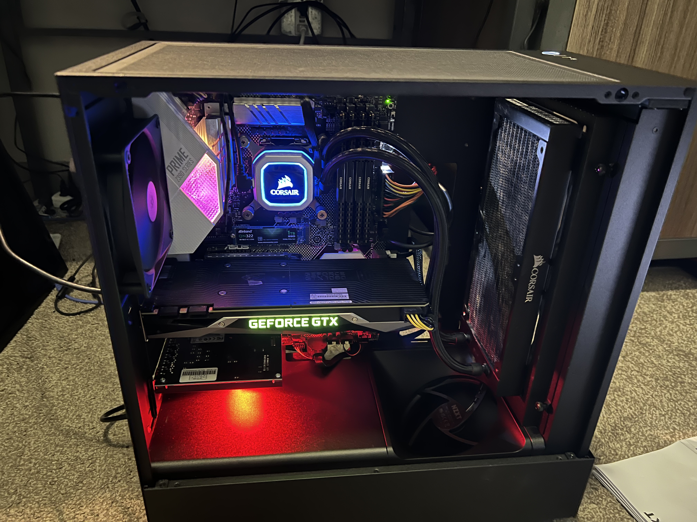
*The old DigitalStorm prebuilt. i7-9700K, GTX 1080, 32GB DDR4. Top-of-the-line in 2017, still respectable in 2023, dead by 2024.*
 
For the rest of the spring 2024 semester I ran my laptop into a monitor over HDMI. It worked, but it wasn't ideal. Among other things, the desk setup looked terrible.
 
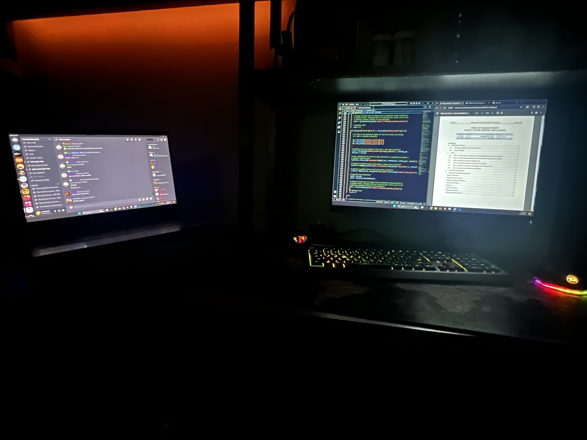
*Stopgap setup for the spring semester. Laptop into the existing monitor over HDMI.*
 

 

 
Two design constraints drove everything:
 
The first was longevity. I wanted the new machine to last 5+ years comfortably, which meant buying the current generation's top tier on the major components. The old desktop had punched above its weight performance-wise for six years specifically because it shipped with the best parts available at the time, and that strategy had worked.
 
The second was form factor. The old tower was huge, heavy, and had persistent motherboard RGB that I never figured out how to turn off in software. The lights stayed on even when the computer was shut down, which meant pulling the PSU switch every night to actually get my room dark. Anti-RGB was a hard requirement on the new build. And once I started looking inside the old case I realized how much of the volume was wasted empty space, which led me to ITX as a form factor.
 
Researching ITX builds, I found content creator [Devyn Johnston](https://www.youtube.com/watch?v=d2IHcpCWndc), who specializes in small-form-factor builds. One of his videos featured the [SSUPD Meshroom S V2](https://www.amazon.com/SSUPD-Meshroom-Mini-ITX-Small-Factor/dp/B0C5XNFCT4/): large enough not to severely constrain part selection, small enough to fit on a shelf. That solved the case question, which in ITX is the question that decides everything else.
 
From there the parts list came together by picking the current-generation equivalent of every component in the old machine:
 
- Intel i7-14700K
- NVIDIA RTX 4080 Super Founders Edition
- 32GB DDR5 at 6000 MT/s
- 2TB SSD to start, with room to expand later

 

 
The 4080 Super was a problem I hadn't budgeted for in the timeline. The card had launched a few months earlier, supply was thin, and every time NVIDIA or Walmart restocked it sold out within fifteen minutes. Bots, scalpers, real demand, hard to say in what mix. Microcenter never stocked anything above a 4070 the entire time I was looking.
 
I'd already worked out with my dad that I'd front the money against my student job income, so the green light was sitting there. I just needed a restock to actually happen in front of me. Late on April 22, 2024 I caught one on NVIDIA's site and placed the order as fast as I could click. It arrived on April 27.
 
I had finals to finish, so I put the card in a closet and didn't touch it for two weeks.
 
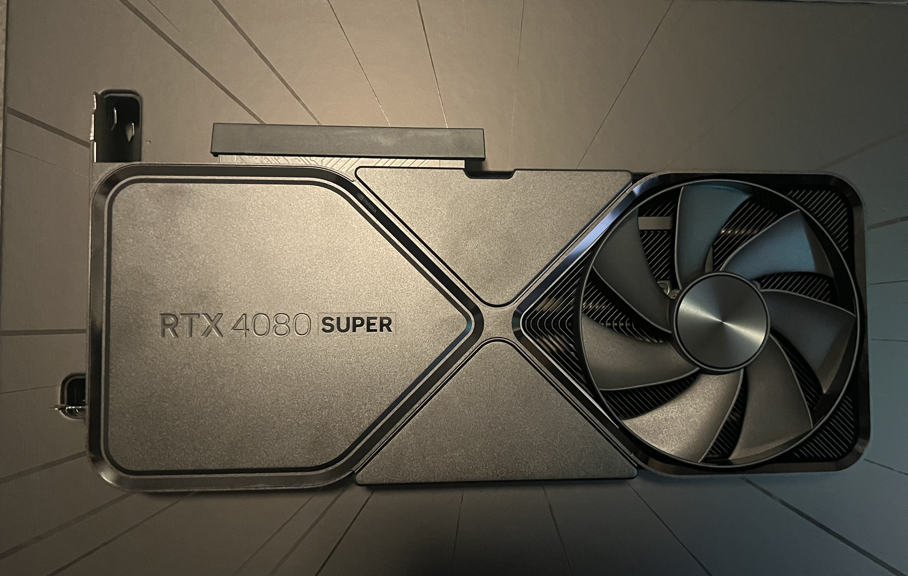
*RTX 4080 Super Founders Edition. Sat in the closet from April 27 until I finished the semester.*
 

 

 
Picked up the rest of the components on May 6, then spent May 9–10 actually putting the machine together.
 
The Meshroom case ships with a build guide that's genuinely thorough but a little hard to navigate. The configuration you follow depends on GPU and CPU cooler size, so the first job is figuring out which section of the manual actually applies to you. Once I'd located the right path the build itself was straightforward, about two hours from "everything on the desk" to "POSTs successfully." The only real misstep was that I did essentially zero cable management on the first pass, so the inside looked like a wiring closet.
 
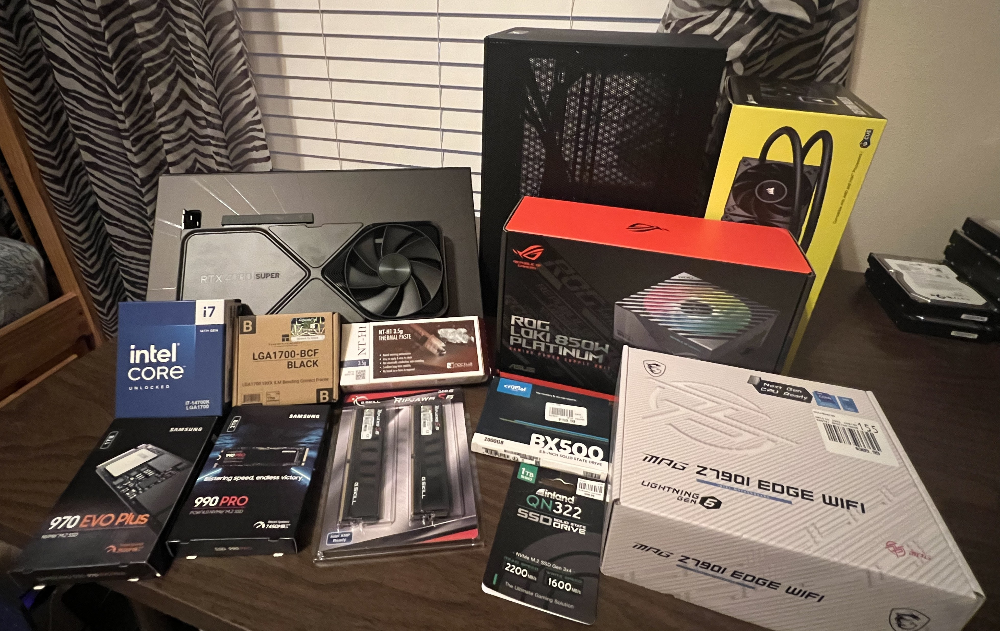
*All components laid out before the build. CPU, AIO, GPU, motherboard, PSU, case, RAM, drives.*
 
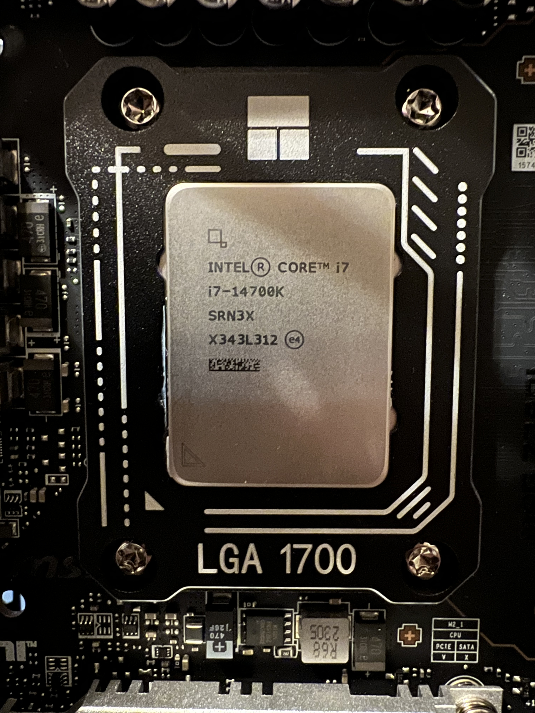
*i7-14700K seated, ready for the AIO mount.*
 
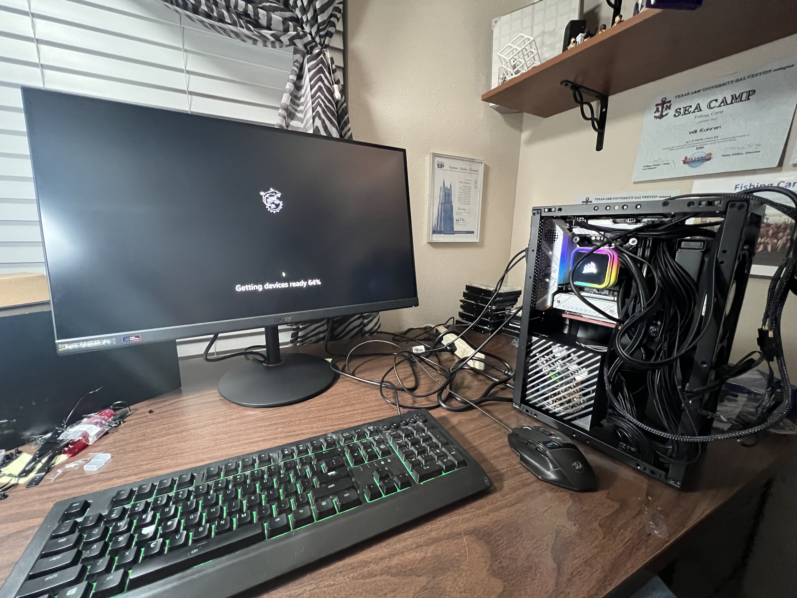
*First POST. Cable management at this point was approximately nonexistent.*
 
One small modification during assembly: I flipped the radiator fans from a push to a pull configuration. The push orientation put more bend stress on the AIO hoses than I was comfortable with given how tight the routing was. I also added fan grills on the intake side to keep stray cables from getting eaten by the fan blades, since the interior was crowded enough that I didn't trust everything to stay where I'd zip-tied it.
 
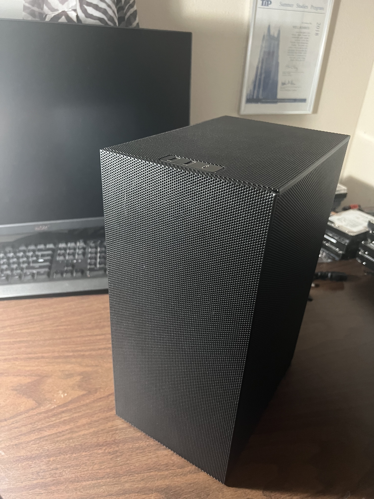
*Outside view. Mesh panels on essentially every face.*
 
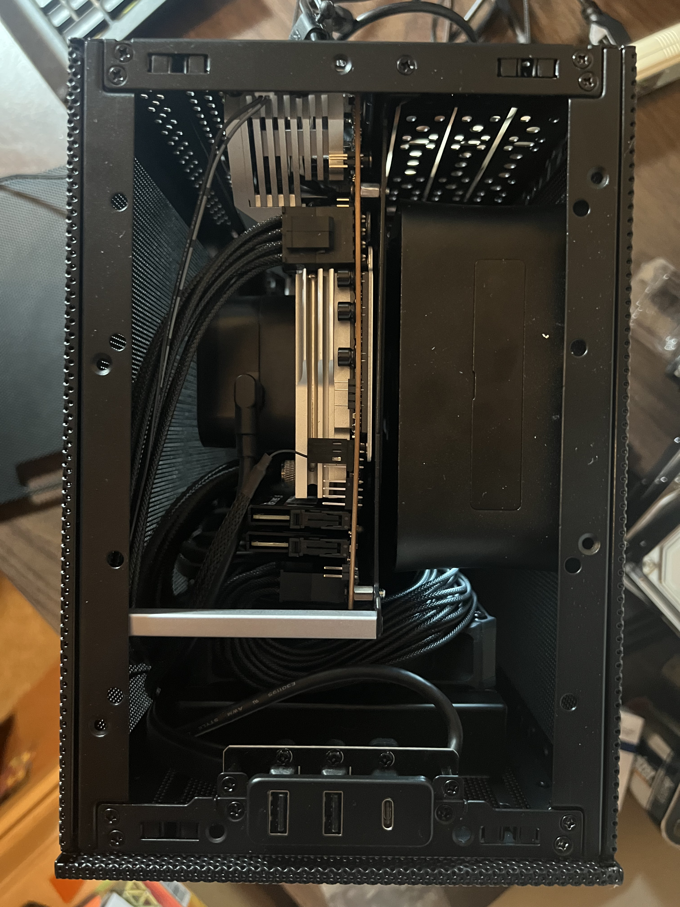
*Top-down with the side panel off. AIO mounted on the front, GPU running vertically beside it.*
 

 

 
Once the machine was working, a couple of small additions made sense.
 
I picked up a slim Noctua fan and mounted it at the top of the case as an exhaust, since the ITX layout doesn't naturally vent hot air upward and the AIO was dumping its heat into a fairly enclosed volume otherwise.
 
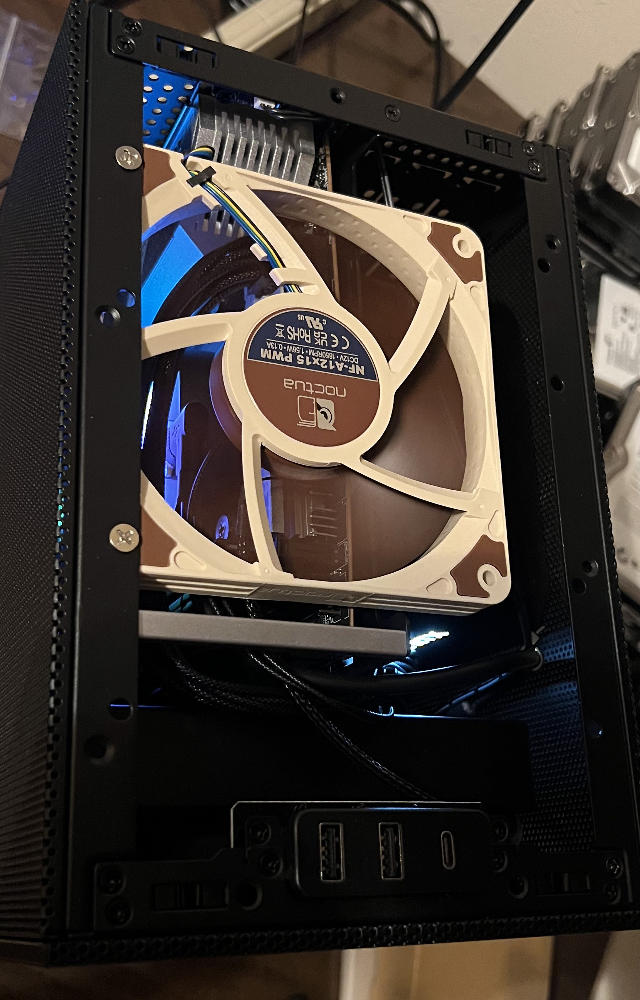
*Slim Noctua fan added at the top of the case as an extra exhaust path.*
 
I also had a 2.5" SATA SSD that I needed somewhere to mount, and the inside of the case had no good remaining real estate for it. So it lives on the outside, on the back panel.
 
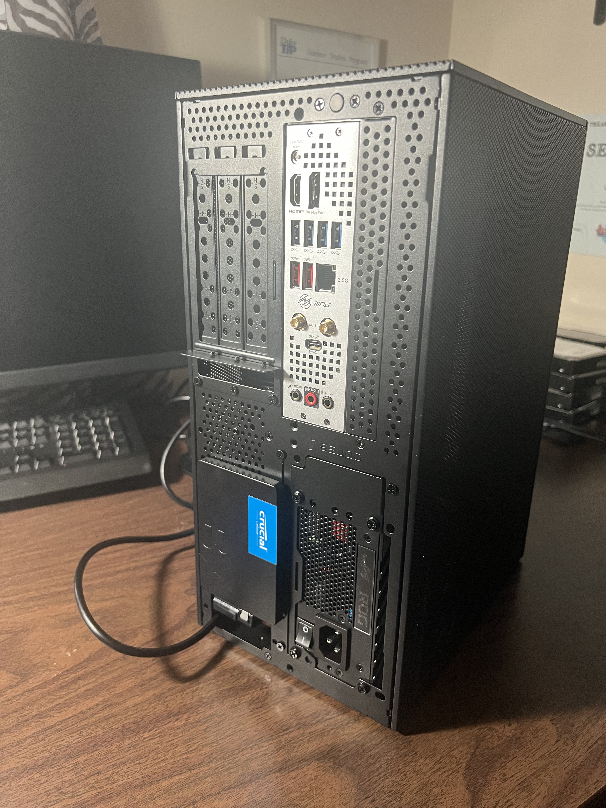
*The 2.5" SSD didn't fit anywhere on the inside, so it's bolted to the back of the case. Functional. Not subtle.*
 

 

 
The machine has sat on the shelf above my desk since May 2024, doing exactly what I wanted it to do. It's small enough to sit on a shelf, quiet enough that I don't notice it, and the only LED that ever turns on is the iCue logo on the CPU cooler, which can be disabled in software, unlike the old machine's motherboard lights.
 
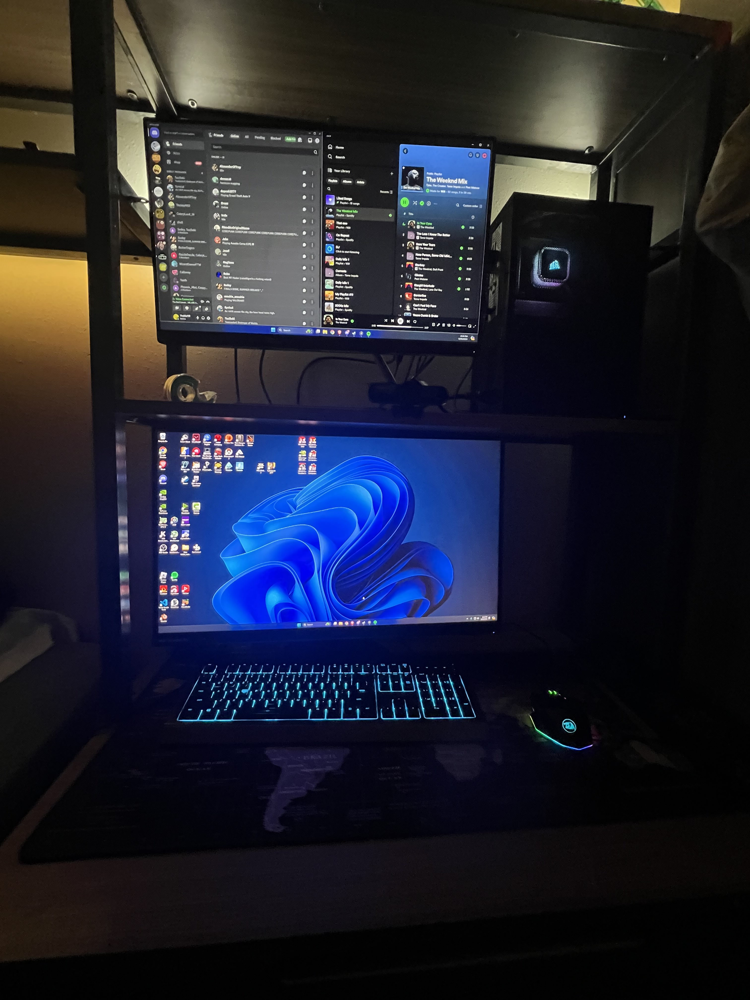
*Final setup. Machine on the shelf, monitor below, no glowing lights at night.*
 
Total damage on the initial build was about $2,930. High but in line with what the parts list cost in mid-2024, and on track to amortize fine over the 5+ year lifespan I was targeting. I've added storage and RAM since, but those upgrades are for a different page on a different day.
 

 
---
 
# 
