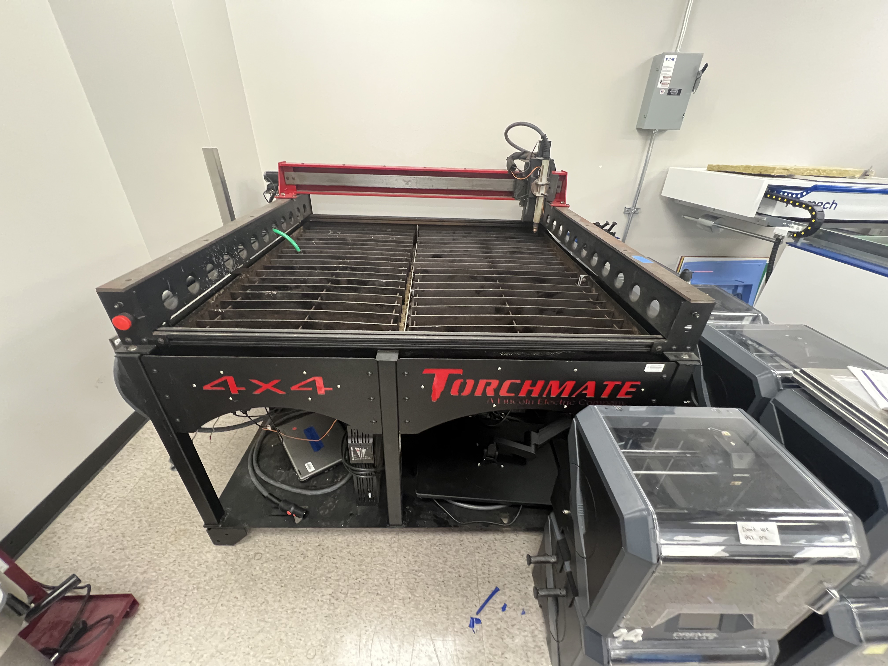
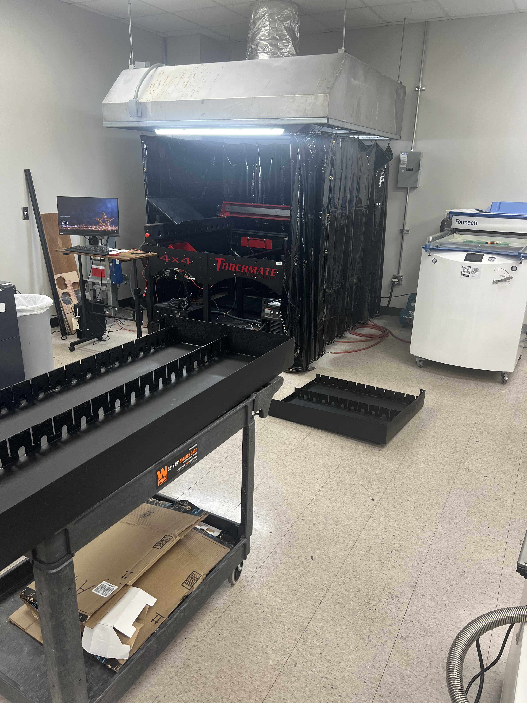
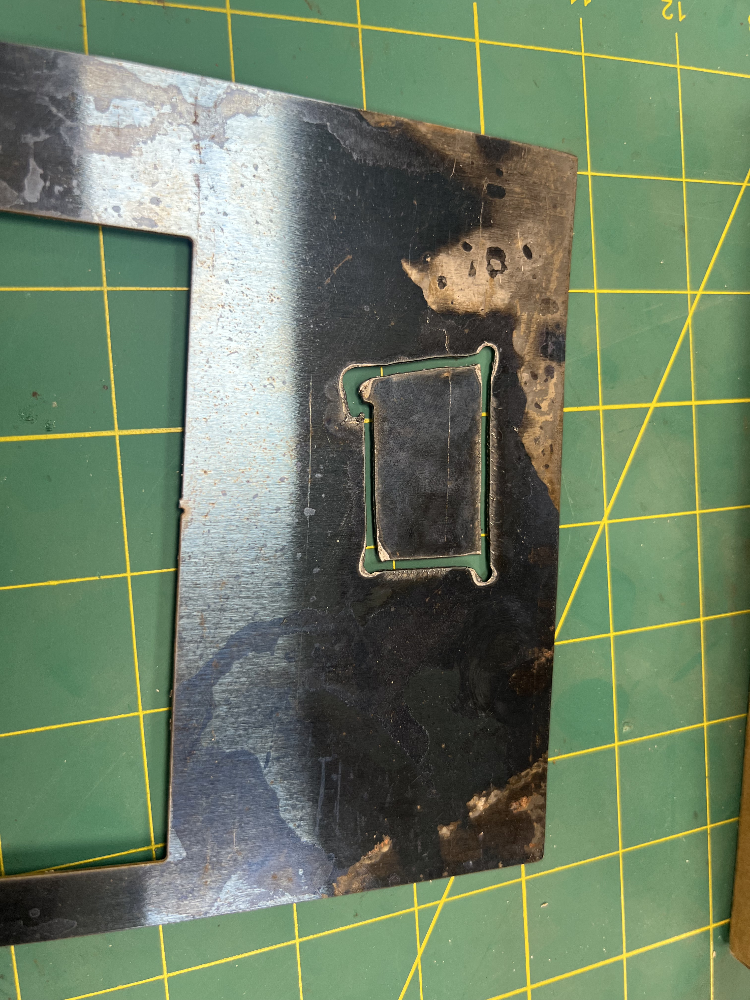
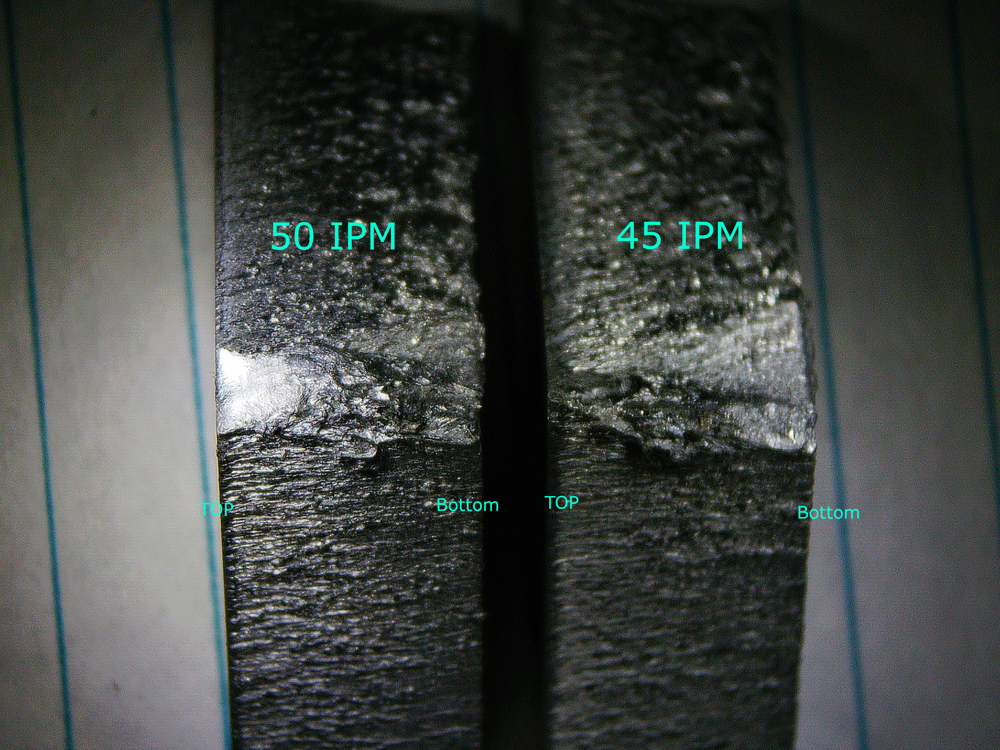
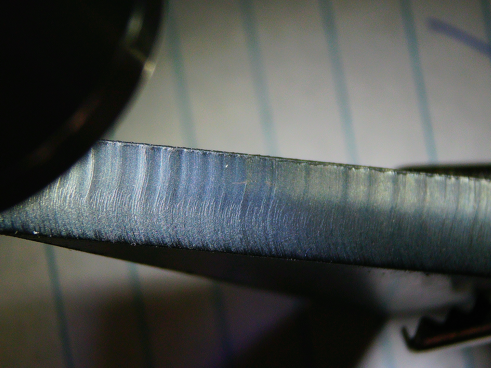

A Torchmate CNC plasma cutter sat unused for five years before landing in our shop. Then it became my problem to solve.

**STATUS:** Fully operational. 34-page SOP published, eight staff trained, in regular use for student and capstone jobs.
 
<!--more-->
 
# 
 
---
 
### Background
 
The Rapid Prototyping Studio (RPS) at Texas A&M is the makerspace where I work as a student technician. Sometime in the late 2010s, researchers in our building (JCAIN) bought a Torchmate CNC plasma cutter, never used it, and left it to sit in a back room for about five years. In May 2024, the machine was relocated to the RPS with the intent of bringing it online as part of our equipment lineup. By the time the dust settled on that move, it had become my project.
 
I knew nothing about plasma cutting going in. By the time the project wrapped, I had a 34-page SOP, a working machine, and a reputation as the person to talk to about it.
 
---
 
### Project Timeline
 

 
The machine arrived in our shop in May 2024 and immediately ran into the first major obstacle: ventilation. Plasma cutting produces hazardous fumes (vaporized metals, ozone, oxides of nitrogen), and our space wasn't equipped to handle it. The summer was spent putting a 2'×2' hole through the concrete ceiling and installing an industrial fan as the exhaust point.
 

*The plasma cutter in its new home in the RPS.*
 
After the vent hood went in, the machine sat untouched for several more months. The RPS had just rolled out a new reservation-based training system that semester, which consumed most of the staff bandwidth and pushed the plasma cutter back in priority.
 
The first real progress came in mid-December, the week after fall finals. Concurrent with another shop project (the LF3DP), I started bringing the cutter online: recoating the waterbed in silicone to stop water from leaking through the seams, installing a fire-retardant welding curtain around the workspace, and coordinating with Torchmate to remotely reprogram the Accumove 2 controller (the box that runs the CNC motion side of the machine).
 

*Recoating the waterbed with silicone to seal the leak points.*
 

 

 
Coming back from winter break, I made a comprehensive list of everything that still needed to be done before the machine could run safely. Machine inspections, fixing wiring mistakes left over from the previous owners, sorting out the control software stack (Torchmate CAD/CAM on the design side, VMD on the machine-control side), and a handful of smaller items.
 
By January 31st, 2025, every item on that list was checked off, and I got to be the one to run the first test cut.
 

*The first successful cut on the resurrected plasma cutter. Roughly 24 gauge steel, low-quality stock, but everything worked as expected.*
 
The first cut was on a thin piece of questionable steel: about 24 gauge, low quality, nothing demanding. The cut quality was rough, but every system worked the way it was supposed to and nothing exploded. From an engineering standpoint, that's the bar.
 
Over the following weeks I started running progressively heavier and more demanding test cuts: 12 gauge stainless, 3\/8" aluminum, 1\/4" mild steel. The list of materials I'd cut grew steadily.
 

 

 
Plasma cutters are common in machine shops, but learning one from scratch (without a mentor, without a co-worker who knew the specific machine) meant a lot of digging through hundreds of pages of operator manuals, manufacturer cut charts, and outdated YouTube tutorials. By the time I'd run twenty or thirty cuts, I had a working understanding that nobody else in the shop had.
 
So I wrote it down. The result was a **34-page Standard Operating Procedure** covering everything I'd learned: the physics of how plasma cutting actually works (the arc starts with ~15 kV at 2 MHz to ionize air to roughly 40,000°F, then drops to ~124–147 VDC to sustain), required PPE, software setup for both Torchmate CAD\/CAM and the VMD machine controller, kerf compensation, dry-run procedures, consumable wear inspection, water level management, material-specific cut charts, edge-cut handling, and a troubleshooting appendix.
 
The document was originally drafted in Google Docs and later ported to the RPS Wiki.js system as part of standardizing onboarding materials across the studio.
 
A video tutorial was on the table at one point but got pushed back internally. Written documentation has been enough to handle staff training without it.
 

 

 
A few sample cuts that show what the machine can do. Cut quality varies significantly by material: mild steel is the cleanest, stainless is rougher, aluminum is the worst. The reason for the aluminum gap is genuinely interesting:
 

 
We use compressed air as the plasma gas, which is mostly fine for steel but is a real problem for aluminum. The oxygen in the air reacts with the molten aluminum almost instantly, forming aluminum oxide along the cut edge. Aluminum oxide melts at roughly 2050°C, compared to about 660°C for pure aluminum. You're trying to cut through a material that the cutter has just made significantly harder to cut. The result is a rough, dross-laden edge.
 
The fix is using an inert plasma gas (typically nitrogen or argon-hydrogen mixes), which prevents the oxide from forming in the first place. We don't have inert gas on tap in the RPS, so aluminum cuts stay imperfect. It's a known tradeoff rather than a problem to fix.
 

 
3\/8" Aluminum side profile. Note the visible dross and rough edge.
 

*3\/8" aluminum cut edge. The roughness is the aluminum oxide problem in action.*
 
1\/4" Mild Steel side profile. Significantly cleaner.
 

*1\/4" mild steel cut edge. This is closer to what a clean plasma cut should look like.*
 
Small rectangular cut in stainless steel for a student job:


 
Larger rectangular cut in stainless steel:
 

 
Two passes cutting 1\/32" aluminum. The second pass lands directly on top of one of the steel slats in the waterbed grate, which causes the extra sparks shooting off:
 

 
Materials I've cut to date span 11 gauge through 3\/4" mild steel, up to 1\/4" stainless, and up to 3\/8" aluminum.
 

 

 
The machine has been fully operational for over a year now. I've since trained eight other RPS staff members on it. Unlike our 3D printers (where students get trained and then reserve machines to run their own jobs) the plasma cutter operates on a "we run your job, you watch" model. Students bring a part, I run the cut, and they're encouraged to be present so I can ask clarifying questions about what they actually need (kerf direction, edge quality requirements, whether they care about the inside vs. outside of a cut). It works better than self-service for a machine with this many failure modes.
 
Spring 2026 was by far the busiest semester the cutter has seen: about a dozen student jobs (compared to the usual 2-3 per semester), plus around 12 hours of after-hours runtime for my capstone project.
 
The next step on the software side is owned by our full-time machinist, who's been working on a Fusion 360 post-processor to replace Torchmate's aging CAD\/CAM software. Last I checked he had it generating valid G-code; what's left is implementation and getting people trained on the new toolchain. Once that lands, the design-side workflow will be substantially less painful than it currently is.
 

 
---
 
# 