Structures engineer on the Texas A&M SAE Aero Design Regular Class team since May 2025. I owned the nose structure: a topology-optimized balsa truss that carried the motors and nose gear through a full season with zero structural failures. Since September 2026 I'm Product Owner for Structures, co-leading the 9-engineer structures subteam for the 2026-27 airframe.

**STATUS:** '25-'26 season: 5th overall at SAE Aero East. '26-'27 season in progress as Product Owner, Structures.
 
<!--more-->
# 
Cover image taken by [Luis Albos!](https://www.linkedin.com/in/luis-albos/overlay/contact-info/)
 
### What is SAE Aero?
 
SAE Aero Design is an international engineering competition where student teams design, build, and fly radio-controlled aircraft within a defined ruleset. Anyone can build something that flies. The actual goal is to maximize a scoring function that rewards payload capacity, structural efficiency, and design documentation quality. Every gram you shave off the airframe is a gram you can put in the payload bay.
 
### What class? What's SMS?
 

 
#### The Three Classes
 
**Regular Class (my team)** is the heavy-lift division. This year's constraints: 10 ft wingspan limit, 2200 mAh battery, and either two motors with 12" propellers or four motors with 9" propellers. Our team ran the two-motor configuration. The scoring formula awards 4 points per empty bottle carried and 15 points per filled bottle, averaged across your top three flights. So maximizing bottle count is the primary objective, and bottle count is ultimately a function of internal volume, which means obsessing over structural efficiency at every level to free up as much fuselage space as possible.
 
**Micro Class** is the nimble flyer division, penalizing excessive wingspan and rewarding short takeoff distances under 10 ft while carrying a liquid payload.
 
**Advanced Class** is the autonomous systems division, rewarding planes that can use onboard telemetry to deliver a payload to a GPS-designated target.
 
#### What's SMS?
 
The team is organized into two engineering disciplines: **ASC** (Aerodynamics, Stability & Controls) and **SMS** (Structures & Materials Science). ASC owns the aerodynamic design: airfoil selection, wing sizing, stability analysis. SMS owns everything structural: fuselage, nose, wing spars, empennage, and making sure none of it fails under load. I joined as an SMS engineer, and by the time competition season rolled around, the nose structure had become my primary ownership area.
 

 

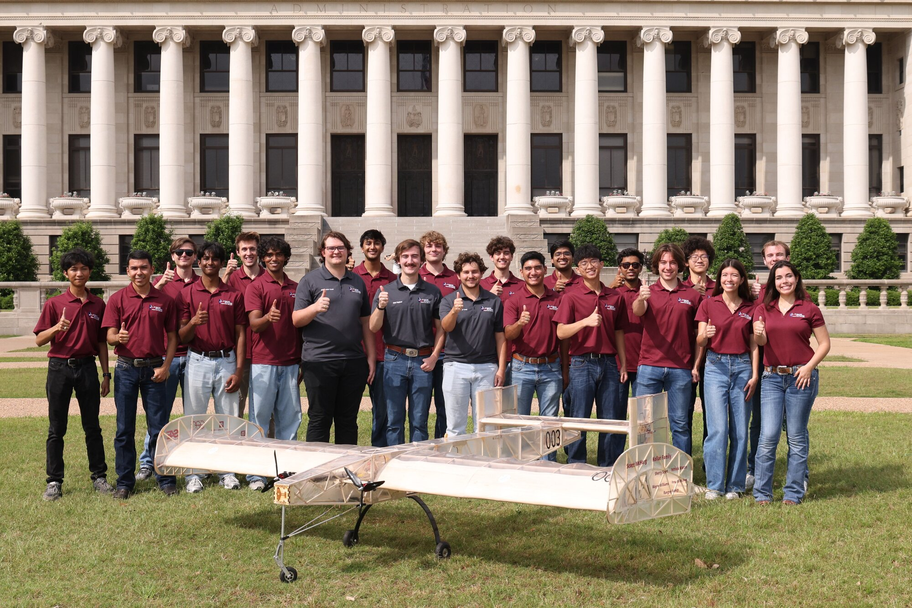
*Regular class team picture post-competition*

---
 
### '25–'26 Season Timeline
 

 
I joined the team in late May with zero prior aerospace structures experience. The first few weeks were sort of a ramp-up: getting comfortable with the Solidworks practices (body coordinate system), functions (weldments), and above-all practicing modeling these structures. With so many solid bodies, Solidworks models can end up "breaking" if care isn't taken when modeling. 

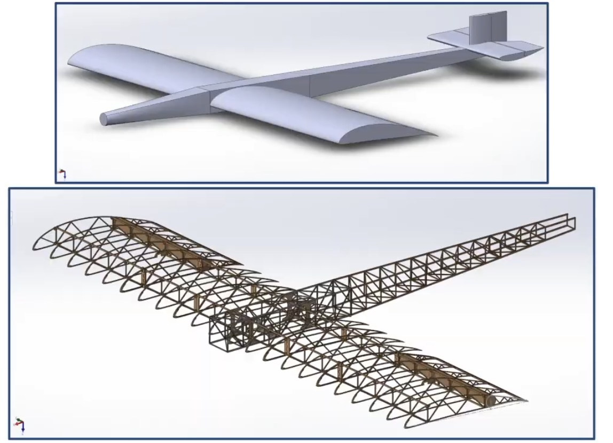

On the analysis side, I started in **Femap** for Finite Element Analysis (FEA) for running my first structural simulation on the center section. Somewhere around late June I switched over to **Ansys Mechanical** for the main wing analysis, which I found easier to set up, with a shallower learning curve than Femap. 
 
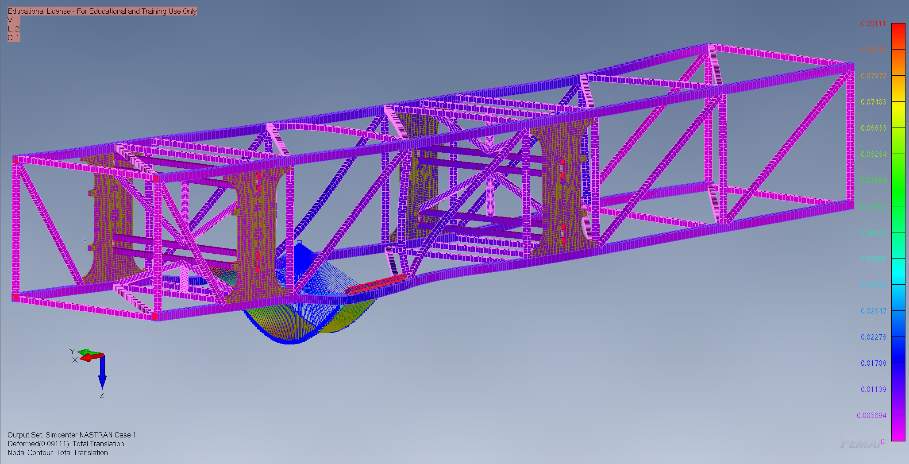

The 2026 ruleset was released in late August, and from there the ASC team went into full tilt on making our planform. Choosing an airfoil, selecting a power train, averaging weather conditions in Florida, sizing control surfaces, modeling dynamics, and everything else that goes into plane design. During this time, I looked into Ansys' topology optimization (Top Opt), because one of our members, Harrison Harding, found that adding wingplates to our plane would decrease drag, and increase efficiency, which would eventually lead to more points. 

Wingplates posed a big structural problem, though, since they potentially can add a lot of mass to the wingtips, which would increase our moment of inertia. To solve this, I intended on letting Ansys suggest a structure layout for me. After no less than 50 different attempts over roughly 60 hours of work, I kinda hit a wall, and was forced to conclude that Top Opt was not capable of generating wingplate solutions. That being the case, I still benefited massively from the experience. 

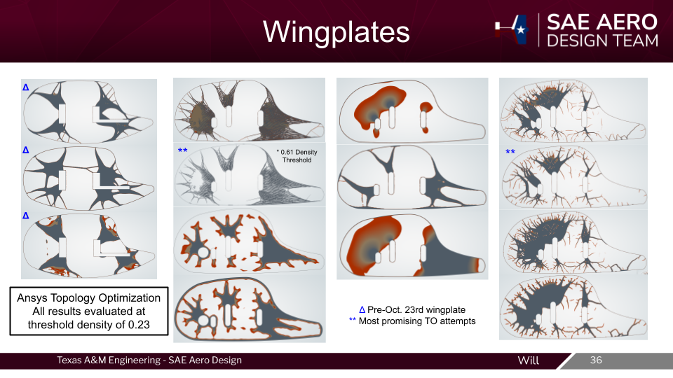
 

 

 
#### The Nose Beam Concept

Eventually, we got to our Critical Design Review, and our project advisor rightly called us out on reusing CAD from the previous year. To summarize, we had a few members that did not follow through on their tasks, which forced the officers into using old 3D models. After reaching late October with only hand-drawn sketches to show for motor-connection ideas, our chief officer, Edward Eiche, assigned me the task of figuring out how we were *actually* going to mount the motors to our plane. He helped me isolate the task, and we decided that mounting them to the nose was optimal, since I could work on that independently, while other members were actively working on the main wing. As such, the "Silly Member" was born, and for the rest of the year I would have sole ownership of the design of the nose. 

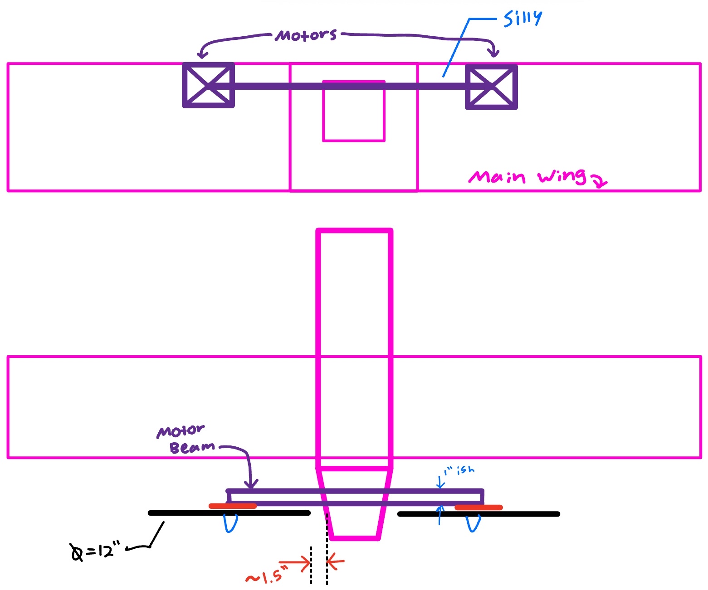
 
After a lot of back-and-forth discussions to weigh the Aerodynamic and Structural pros/cons, we decided that it was a route worth going down. So I set out to make the best nose SAE Aero has ever seen. 

#### Applying Topology Optimization (This Time It Worked)

After spending so much time with Top Opt on the wingplates, I found that the nose was a much better use-case, and it was a really quick setup process, relatively speaking. With topology optimization, the idea is not to directly use its output solution as the final model, since we cannot get our balsa wood to exactly match its organic contours. Part of the work in post processing is to model a manufacturable version of the solution it comes up with, which is shown below. 
 
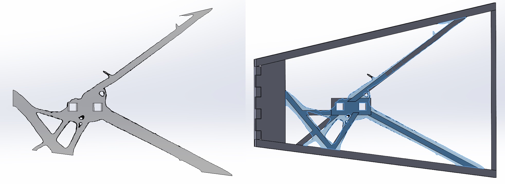
 
#### FEA on XP1 Nose
 
With my initial nose CAD, I ran the Ansys FEA with two independent load cases:
 
- **Landing load**: 25 lbf upward at the nose gear attachment point
- **Motor load**: 12 lbf on each motor plate in the thrust direction
Results on the first iteration:
 
| Load Case | Max Von Mises Stress | Yield Strength | FoS |
|---|---|---|---|
| Landing | 894 psi | ~2000 psi | 2.24 |
| Motor Thrust | 737 psi | ~2000 psi | 2.70 |
 
The stress concentrations showed up at the motor spar interfaces, which was expected. Conclusion from that run: go back to 0.25" balsa longerons, which brought the final design stress down to ~750 psi with a margin of safety of 0.85. That's above the team's structural MoS requirement of 0.2.
 
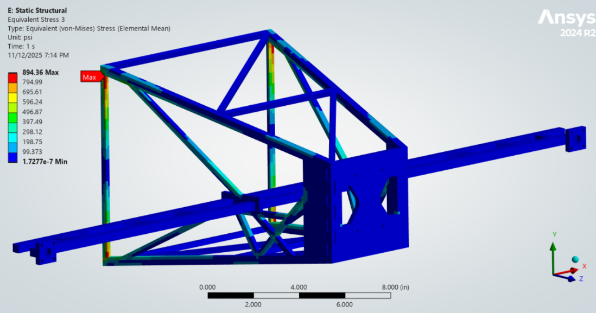
*Ansys Von Mises stress contour, landing load case. Max stress at motor spar connection.*
 
#### XP1 Build & Flight Test
 
We built the XP1 nose and integrated it with the center section. XP1 flew well. It's hard for me to quantify just how well it flew as a mechanical engineer (plus I was on winter vacation for all the flight tests), but it was so good that we removed the wingplates to verify the CFD data, and we loaded it 5 lbs above its designed MTOW. We ended up crashing that flight, due to an aerodynamic failure (not enough lift), which led to a rapid unplanned disassembly. 

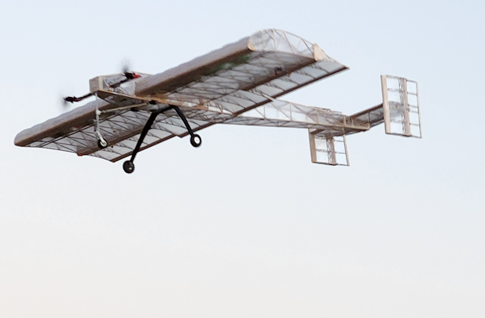
*Picture of XP1 flying without wingplates*

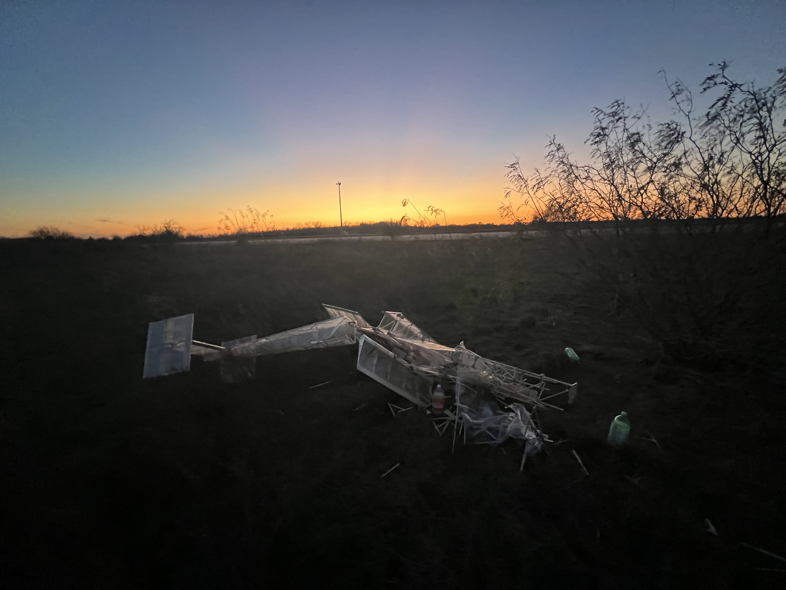
*Picture of XP1 after crashing at 45 lbs MTOW*
 

 


After the success we had with XP1, ASC went back to the design phase and made some major revisions to the airfoil, empennage, nose, and control surface sizings. The proportions of the fuselage underwent some big changes, as well as using a new custom airfoil. 
- Tail boom 61" >> 38.3"
- Nose 12" >> 24"
- Center Section 42" >> 48"

Since I had pioneered the design of the XP1 nose, my task over winter break was to design the new nose for XP2. From my vacation in Minnesota, I was able to prepare the Ansys setup on my laptop, transfer those files to my desktop in College Station, and run it there. 

---
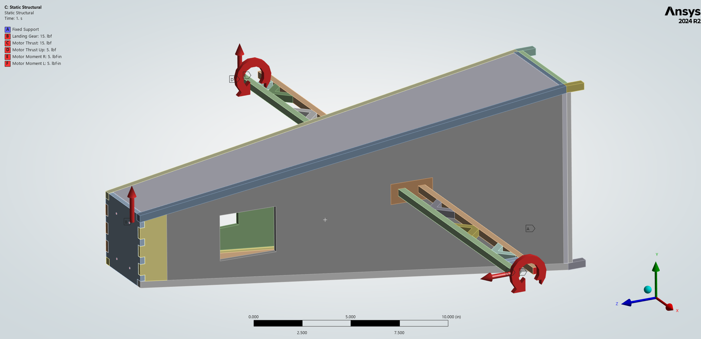
*Ansys setup for nose topology optimization*

---
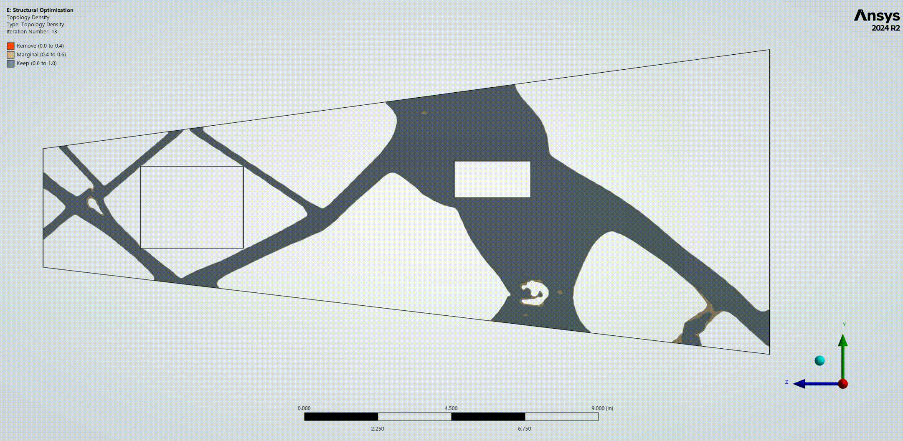
*XP2 nose topology optimization solve gif*

---
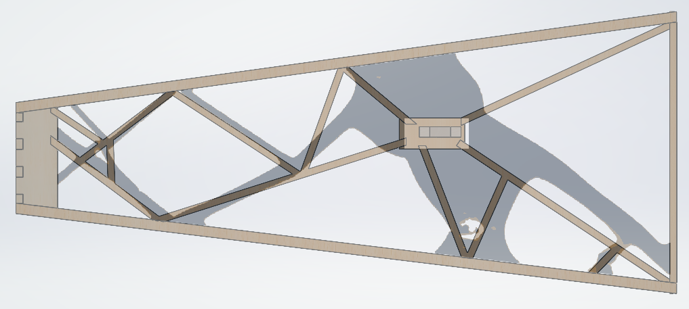
*XP2 nose CAD post top opt (post processing)*

---
Topology optimization was attempted on the top/bottom plates of the nose, though the setup does not contain any side loading, so the results weren't very impactful. Instead the top/bottom plate designs were motivated from the need for hatches in order to access the electronics, and to place a 4 lb ballast bottle in the very front of the plane to help the placement of the center of gravity.  

---
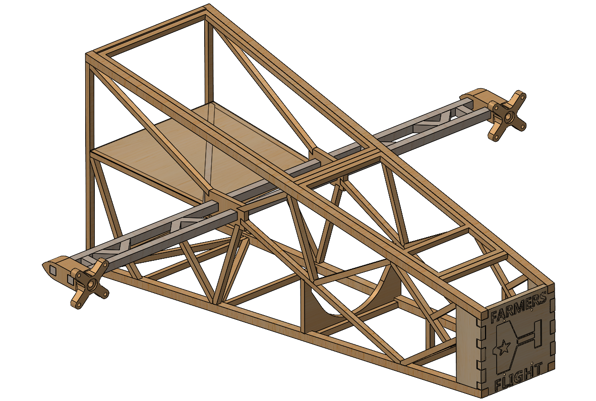
*XP2_Nose_WR_V11.SLDPRT - Final version of the Nose for XP2/CP1-2*

---
With the nose updated, and the other members having similarly updated the designs for the center section, main wing, and empennage structures, we had our eXperimental Plane 2 (XP2). 

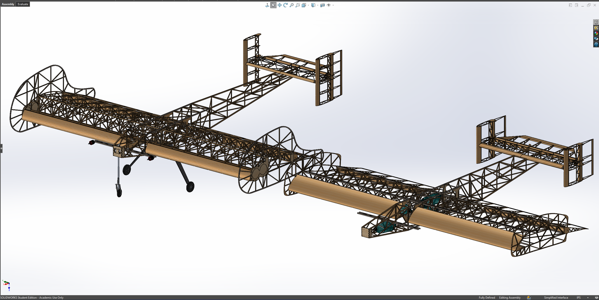
*XP1 (left) and XP2 (right) side-by-side*
 
XP2 flew well enough that it got promoted: it became **CP1**, Competition Plane 1.



*CP1 Taking off during the Feb 21 flight test*

---



*CP1 Landing during the Feb 21 flight test*

---


 


As a precautionary measure before going to competition, we've historically built at least two planes so that if there were to be an "*unexpected rapid disassembly*" that we can still have a plane to score points with. This also provides the opportunity for us to be more efficient/optimized with the construction of the plane, since we would have already solved all of the design problems that inevitably arise. Every little bit matters for this competition, down to how many drops of superglue are used on each joint of each rib. 

Our school was selected to participate in the SAE Aero East division, whose competition was slated for March 6-8th, which is **EXTREMELY** early compared to other years (normally it doesn't take place until May). One of my biggest frustrations with SAE Aero was how rushed our timeline was due to the early competition. XP2/CP1 build was done by January 28th, at which point CP2 build was started. The goal was to have CP2 done and ready to fly at least a week before competition so that we could have time to test-fly it in College Station to verify everything worked. 



*All hands on-deck in the shop to get CP2 ready to fly (7,500X speed)*

---

We took our time with the construction of CP2 since we wanted everything to be done right, so the build went all the way up to our last flight-test window on Saturday February 28th, three days before we wanted to have the trailer all packed up and rolling towards Florida. To summarize, we had an avionics issue that led to our plane going down into the field next to the runway, where thankfully our amazing pilot, Scott McHarg was able to gently lay it down. The main wing, and tail structures were all perfectly fine, at the tradeoff that the nose was completely destroyed. So with few options left, we had several people pull an all-nighter, where I rebuilt a new nose from scratch, while others checked the plane and repaired some minor damages.  



*CP2 flight test 1 crash at 50% speed*

--- 



*Six-hour rebuild. Night before the trailer left for Florida (1,000X speed)*
 
---


 


The ruleset this year rewards points for every 2L bottle we can pack in our plane, where if the bottle weighs 1 lb it scores 4 points, and if it weighs 4 lbs, it scores 15 points. So from a pure points per pound, "empty" 1 lb bottles are preferred, with the caveat that it requires a LOT of internal volume to store. To address this, ASC picked a really thick airfoil so that we could put bottles into the wing, with a long chord length to generate enough lift. The downside to the thicker airfoil is that it also produces a lot of drag. So much so that in order to fly at our designed MTOW, we *require* about 5-10 knots of headwind, otherwise the battery (2200 mAh) simply isn't big enough to support a full flight. 

With that foreshadowing out of the way, we ended up having a pretty rough time at competition, where the wind just wasn't there. With the new nose I built, and the repairs from the other members, we wanted to redo our maiden flight of CP2 on the first day, which primarily was for technical inspection and team registration. We had yet another previously unforeseen avionics issue where the arming plug melted through partly due to the warmer floridian climate. 

After ANOTHER all-nighter in the living room of our team's AirBNB to fix the plane, we showed up to the first day of actual competition. Thankfully, we had a pretty productive day, and with 5 flight attempts, we got two valid scoring flights which boosted us into the top 5.

The 2nd day of competition, March 8th, though, was less productive, to say the least. We as a team agreed that we wanted to fly conservatively in order to try to get in the top 3, so we loaded up CP2, waited on the flight line for other teams to go, then at 10:35 AM CP2 flew for the last time. We took off, and made it about 250 ft down the runway thanks to ground effect giving us more lift, but as soon as we tried to gain more altitude for the turn, the wind died and we crashed. 

With not a moment to lose we carried the wreckage back to our tent, loaded up CP1, and got back in line as soon as possible to make one final attempt. The flight line was set to close at 12:00 PM, and we were able to get CP1 on the runway at 11:56 AM with the exact same payload configuration, just hoping for better wind conditions. We got in the air, and were actually able to limp the plane all the way down the runway, and all the way back thanks to ground effect & a slight breeze. But on the final turn towards the landing zone, the wind died, and we, for the final time, crash landed. 
 
We finished **6th in flight score** and **5th overall** with design report and technical interview scores factored in.

 

*Full scoring flight of CP1 on Saturday (first day)*

--- 



*Final flight of Competition Plane 2*

--- 


 


I think I can speak for our entire team when I say that we were a bit disappointed with our performance in Florida. I personally chalk it up to bad luck with the weather. 

That being said, I am **proud** of the work that we all put in, and I'm grateful I've been able to meet so many other engineers. 

I've learned so much about what goes into designing a plane, thanks to directly witnessing the full design process from conception to 3d models to full structures. Getting to take ownership of the nose was especially rewarding for me, since it's such a critical part of the plane, and I brought it to life, from a sketch on my iPad, to a model in Solidworks/Ansys, to putting the sticks together and seeing it fly our plane. 

To that end, we had **ZERO** structural failures throughout the year. We broke a lot of plane components, but only when our plane suffered other issues. One of the core design philosophies within the SMS subteam of TAMU SAE Aero is that our components *should* fail in a crash landing. If our plane survives a crash, it's a sign of an overbuilt plane, where we can potentially cut several ounces of structure in order to squeeze out a few more points. 



---
 
### What's Next

Throughout the year, something I noticed with our design workflow, is that the FEA of our components (except for the main wing) were relatively inconsistent. I spent a LONG time trying to simulate my nose, and how it would react to loads that arise from landing and takeoff. I took my best guess at a reasonable acceleration value from looking at several videos, but it was something that bugged me for most of the year. To go further, I was interested in seeing how accurate our FEA modeling techniques are by measuring structural performance against predicted performance in-flight.
 
That's the motivation behind my current project, **SAVIOR**, a custom 4-layer mixed-signal avionics PCB designed to log the aircraft state with a 6-DoF IMU, GPS, and a 16-channel strain gauge array. The goal is to capture real in-flight structural and aerodynamic data and validate the FEA and CFD models against what the airframe is actually experiencing. 
 
Once I get a little further into the project, I'll have a page for this project. 
 
---
 
# 