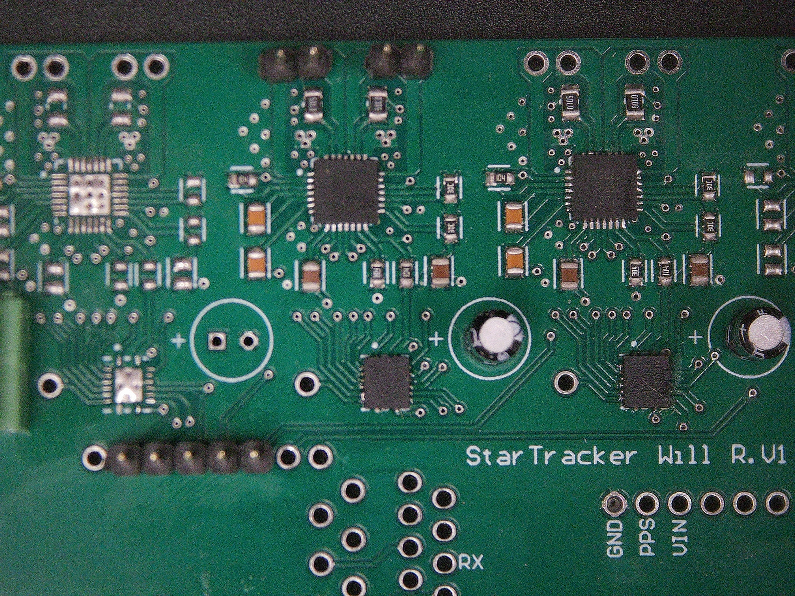
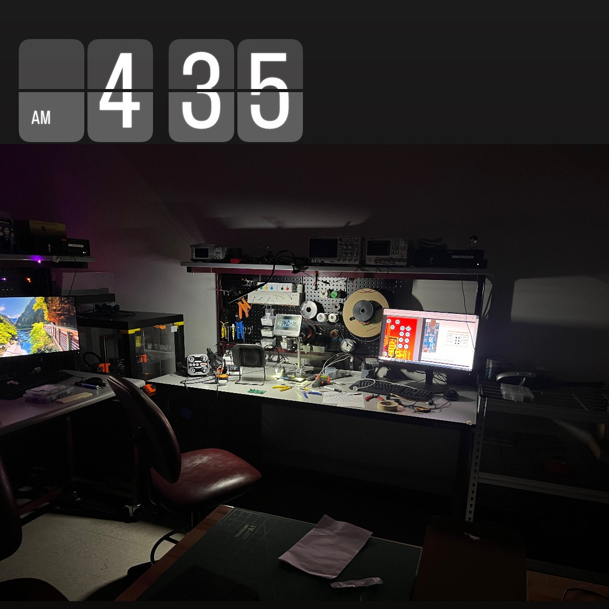

A custom four-channel A4988 stepper driver board, designed mostly so I could batch-order another PCB that month. Adafruit sells the same chip on a breakout for $5. That's the lesson.
 

**STATUS:** Built, never got a stepper to move with it. Retired in favor of off-the-shelf driver modules.
 
<!--more-->
 
# 
 
---
 
### Background
 
In October 2024 I was about to send a JLCPCB order for the [ATmega32U4 dev board](/posts/atmega32u4-dev-board/), and shipping from Hong Kong is the dominant cost on small JLCPCB orders. Anything else I could finish a design for in the same window would essentially ride along for free. I had a project in mind that would need four stepper motors driven simultaneously, ideally controlled by the dev board itself, so a four-channel driver PCB landed on the design list almost by default.
 
The chip choice didn't get much thought. The A4988 is the driver on most of the cheap stepper breakouts you can buy, the project didn't need especially high torque or microstepping resolution, and "use the chip everyone else uses" felt like a reasonable starting point.
 
---
 
### Project Timeline
 

 
Each A4988 needs eight control signals: seven configuration \/ status pins plus a step input typically driven with PWM. Four of those tiled together would have been thirty-two GPIO lines, well past what the dev board could comfortably spare, so the obvious move was to multiplex through shift registers. Specifically the SN74LV595AR, the SMD cousin of the 74HC595 I'd used on the [alarm clock](/posts/alarm-clock/). One register's worth of bits per driver, chained in series, clocked out from the MCU. 
 
.png)
*Initial single-channel routing for the A4988 control signals.*
 
After getting one channel routed cleanly, I tiled four copies together, added decoupling caps at each driver, broke out mounting holes for the dev board to sit on top of, and sent it.
 
.png)
*Final layout. Four A4988s tiled, shift register chain along the bottom, dev board mounting pattern up top.*
 

 

 
Boards came back with thicker outer copper than I'd worked with on prior projects, which made hand-soldering the QFN-style packages slower than expected. The fix was to preheat the whole board on a hot plate first, then use the hot-air gun to flow solder over the IC pads. Solid connections, just slow.
 
Reviewing the layout in Altium one more time after assembly, I caught something that should have been caught at schematic review: the *first* and *second* shift registers in my chain were both connected to the same data-in line, instead of the second register's data-in being driven by the first register's serial-out. The chain wasn't actually a chain. Two registers were running in parallel where I'd thought I had a cascade.
 
Rather than rework the populated board, I skipped the first driver position entirely and populated only positions two and three for testing. Two channels of stepper drive was plenty to validate the rest of the design.
 

*Assembled prototype with positions two and three populated. Position one left empty as a workaround for the shift register chain bug.*
 

 

 
Morning of February 6, 2025, I tried to actually move a stepper with it for the first time, using the V1.1 [ATmega32U4 dev board](/posts/atmega32u4-dev-board/) as the controller. The motor didn't move. Nothing on the scope where I'd expected step pulses, no thermal indication on the drivers, just silence.
 
I swapped to a known-good Arduino Nano to rule out anything dev-board-specific. Same result. I poked at it for another hour or two before calling it a night.
 

*The debugging session that didn't go anywhere.*
 
I never came back to it for a serious second pass, and I never determined the root cause. Best guess in retrospect is that the shift-register workaround left state I wasn't accounting for in firmware. Running two parallel registers and treating them as a chain in code shifts the wrong values onto the wrong control pins. I never validated that hypothesis on the bench.
 

 

 
The real lesson from this one isn't technical. It's economic. A4988 breakout boards from Adafruit, Pololu, or any of a dozen other vendors run about $5 apiece. Four of them on a strip of perfboard, jumper-wired into the dev board, would have done exactly what this PCB was designed to do. Known-good driver layout, zero risk of a shift-register-chain mistake reaching manufacturing, about $20 of parts instead of roughly $60 for the JLCPCB run. And at the end of it I'd have actually had working hardware.
 
There's a class of PCB project that's worth doing custom: something integrating multiple subsystems, something with a form factor that doesn't exist off-the-shelf, something that genuinely teaches a new technique. This wasn't one of those. It was four copies of a circuit that already exists as a commodity module, and the value I got out of it was almost entirely as a negative example. It taught me when *not* to design custom hardware.
 
For any future stepper-driving needs, I'm just buying the modules.
 

 
---
 
# 