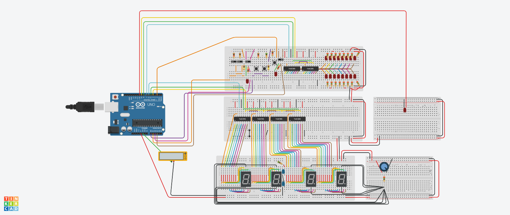
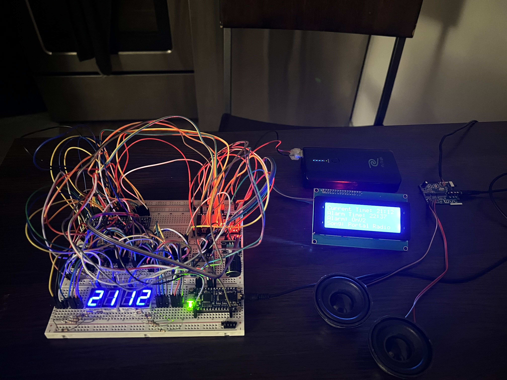
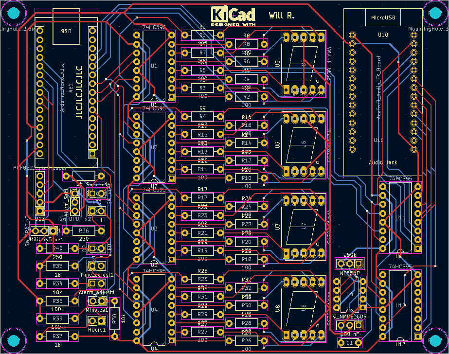
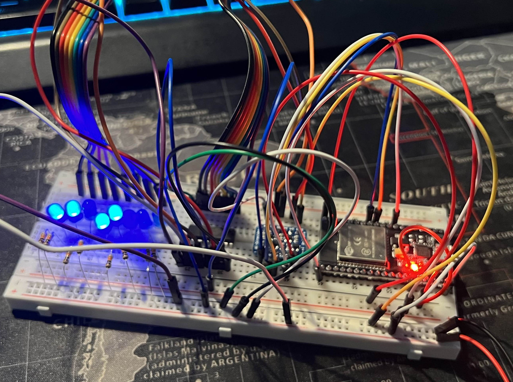
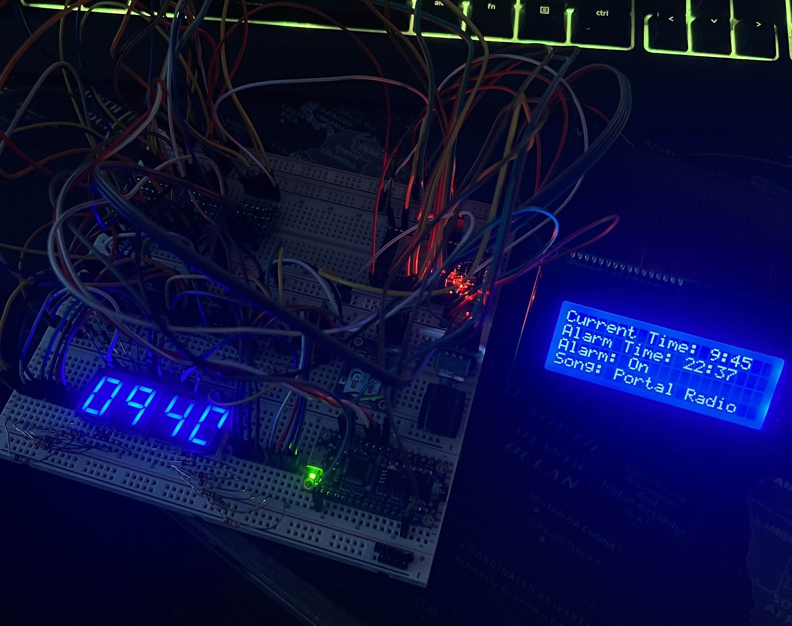
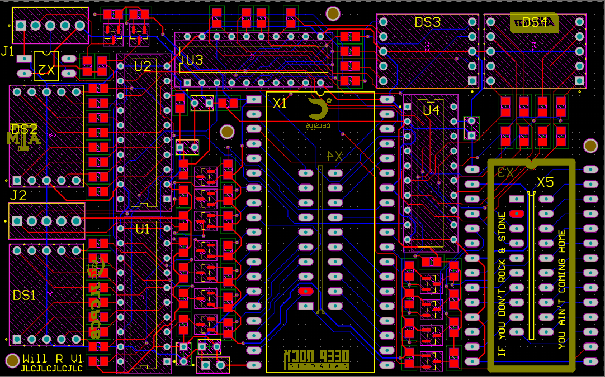
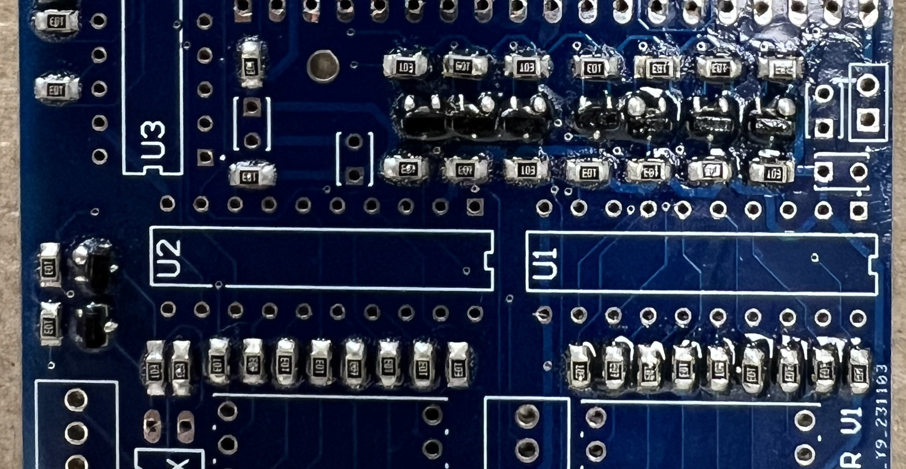
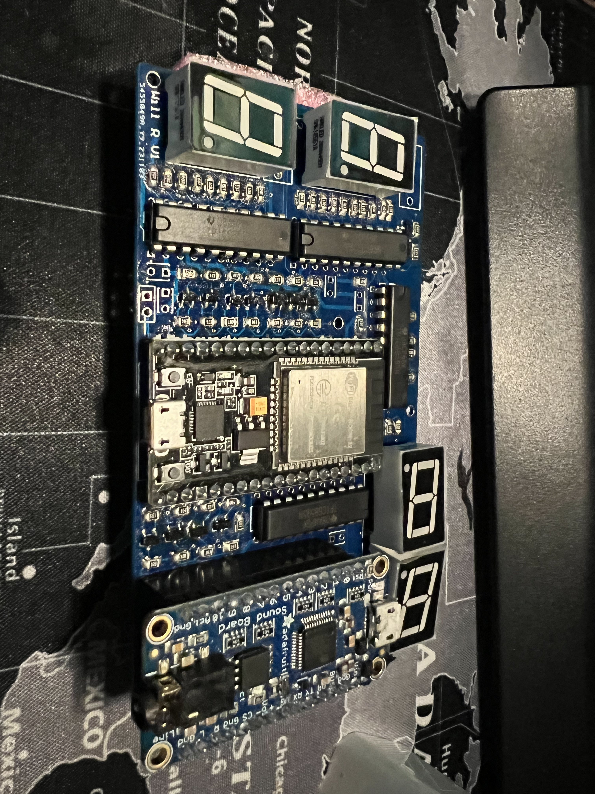
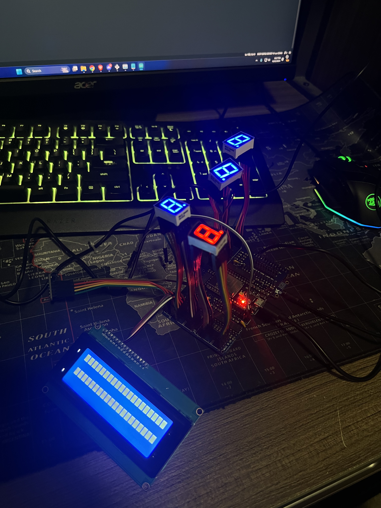

My iPhone's alarm stopped going off one too many times. So naturally, I tried to build my own. Many lessons learned later, I have the tools to soon make my return to this project.

**STATUS:** V2 PCB built; its I2C bus never came up. V3 on an ATmega32U4 is planned.
 
<!--more-->
 
# 
 
---
 
### Background
 
This project started in early 2023 as a way to get hands-on with microcontrollers and digital electronics. I had essentially zero experience with either at the time. No PCB design, no embedded programming, no idea what a shift register was. The alarm clock was a concrete enough problem to give the learning a direction.
 
The goals were simple: use a microcontroller with a Real Time Clock (RTC) module to display the time, set alarms, and make noise when they triggered. Getting there took considerably longer than expected.
 
---
 
### Project Timeline
 

 
Before buying any hardware, I spent time in **Autodesk TinkerCAD**, an online circuit simulator, to figure out if my concept would even work. The simulation ran at single-digit FPS by the time I had everything wired up, which I chose to interpret as a good sign rather than a warning.
 

*TinkerCAD simulation. The FPS was not great. The vibes were*
 
With a working simulation in hand, I bought an Arduino Nano, a handful of 74HC595 shift registers, a PCB soundboard, and an Adafruit RTC module, and translated the design onto a breadboard. I added an LCD screen and rotary encoder for navigation. One for displaying the time and alarm settings, the other for scrolling through menus.
 

*Full breadboard prototype*
 


*Idle animation on the LCD display*
 
It worked. The time kept, the alarm triggered, the display animated. For a first embedded project built entirely from a simulator and guesswork, that felt like a reasonable outcome.
 

 

 
With a working breadboard design, I figured the next logical step in making a truly functional device was a PCB. I started in **KiCAD**, a free PCB design tool, and put together a first layout. Looking back at it now, it was bad in almost every measurable way:
 
- Through-hole resistors everywhere, which eat board space and make routing miserable
- Two extra shift registers added just to trigger the soundboard, instead of using the TX/RX serial pins that were already right there
- 7-segment display footprints placed on the board with no intention of actually soldering the displays to them. Just to have the pinouts accessible, which meant dedicating significant board space to components that would never be populated
- A 555 timer for brightness control instead of just using a PWM pin on the Nano
I never sent this design out for manufacturing, thankfully. I moved on.
 

*The KiCAD layout. There are many things wrong with this. I was learning*
 
At around the same time, I discovered the **ESP32**: faster than the Nano (16 MHz >> 240 MHz), dual-core, built-in WiFi and Bluetooth. On paper, a strict upgrade. I bought the cheapest ESP32 dev boards I could find on Amazon, which, in hindsight, was foreshadowing.
 
The immediate problem: the Nano runs on 5V logic and the ESP32 runs on 3.3V. Every peripheral I'd bought was built for the Nano. Connecting them directly to the ESP32 would fry it. The solution I found was Adafruit's BSS138-based bidirectional logic level shifter. I'd used their breakout board successfully on the breadboard, so I decided to integrate the same circuit directly into my PCB design rather than using the breakout.
 
**MAJOR BLUNDER**
 

*Using the ESP32 with the original shift register to control some LEDs*
 

*Full breadboard prototype with ESP32 and all other functionalities*
 
The ESP32 rabbit hole consumed a lot of time: dual-core task management, watchdog timer behavior, relearning everything I'd figured out on the Nano but now in a different framework with different voltage requirements. I eventually got back to feature parity with the original breadboard design, but it took far longer than it should have. The ESP32 was total overkill for a clock. I know that now.
 

 

 
With the ESP32 version of the circuit working on the breadboard, I was ready to move to PCB design, properly this time. I got access to a student license for **Altium Designer** through a TAMU professor and started over from scratch.
 
The design came together well. I broke out spare ESP32 and soundboard pins in case I wanted them later, added some silkscreen content in the empty spaces for personality, and sent it to JLCPCB.
 

*Altium layout for V2. A significant area-efficiency improvement over the KiCAD attempt*
 
The boards arrived and I assembled them by hand. I made the mistake of skipping the solder paste stencil and applying paste manually to each SMD pad, which is technically possible but results in inconsistent paste volumes and a lot of solder bridges. The boards looked rough. They mostly worked anyway.
 

*This is what happens when you skip the stencil*
 

*Assembled ESP32 PCB*
 

*PCB powered on, but unable to control shift registers nor LCD screen*
 
Most of the functionality came up on first power-on. Most. The LCD, the soundboard, and every other I2C device on the board refused to respond. I tried bodge-wiring a missed connection I found, but no dice.
 
My best diagnosis, in retrospect: the BSS138 logic level shifter implementation was wrong. The Adafruit breakout board had worked fine on the breadboard, but when I integrated the same circuit into the PCB directly, something in my implementation was off. I also never added I2C pull-up resistors to the SDA and SCL lines, a fairly fundamental oversight. I didn't fry the ESP32, which I'm choosing to count as a win, but the I2C peripherals never talked.

There were a LOT of places where I overcomplicated things by trying to do it myself. So on one hand I've learned a valuable lesson, and I've also learned a lot about PCB design & electronics design in general (which was the main goal, at the end of the day). 
 

 

 
Summer classes cut the project short before I could debug further, and I pivoted to other electronics work, most relevantly designing a [custom ATmega32U4 dev board](/posts/atmega32u4-dev-board/) from scratch in Altium.
 
That project turns out to be directly useful here. The ATmega32U4 runs on 5V logic, same as the original Arduino Nano, which means no level shifting, no BSS138 implementation to get wrong, and no 3.3V peripherals to worry about. I have a stockpile of bare ATmega32U4s and the minimal supporting components (crystal, decoupling caps, reset circuit) sitting around from that project. The groundwork is already done.
 
The V3 plan is straightforward by design. The whole point is to stop making it complicated:
 
- **ATmega32U4 as the MCU**: 5V throughout, native USB, well-understood from the dev board work, and I already have the chips
- **All SMT, proper stencil this time**: no through-hole components, ordered with a stencil so paste application is actually controlled
- **No feature creep**: no WiFi, no Bluetooth, no dual-core anything. It's an alarm clock. It needs to tell the time and make noise.
- **Add the I2C pull-ups**: 4.7kΩ on SDA and SCL. This one still hurts to write.
- **Batch the order**: JLCPCB charges per-shipment, so the V3 board will go out alongside whatever else I'm having manufactured at the time to avoid paying shipping twice.
Tentative plan is to spin V3 during Summer '26.
 

 
---
 
# 