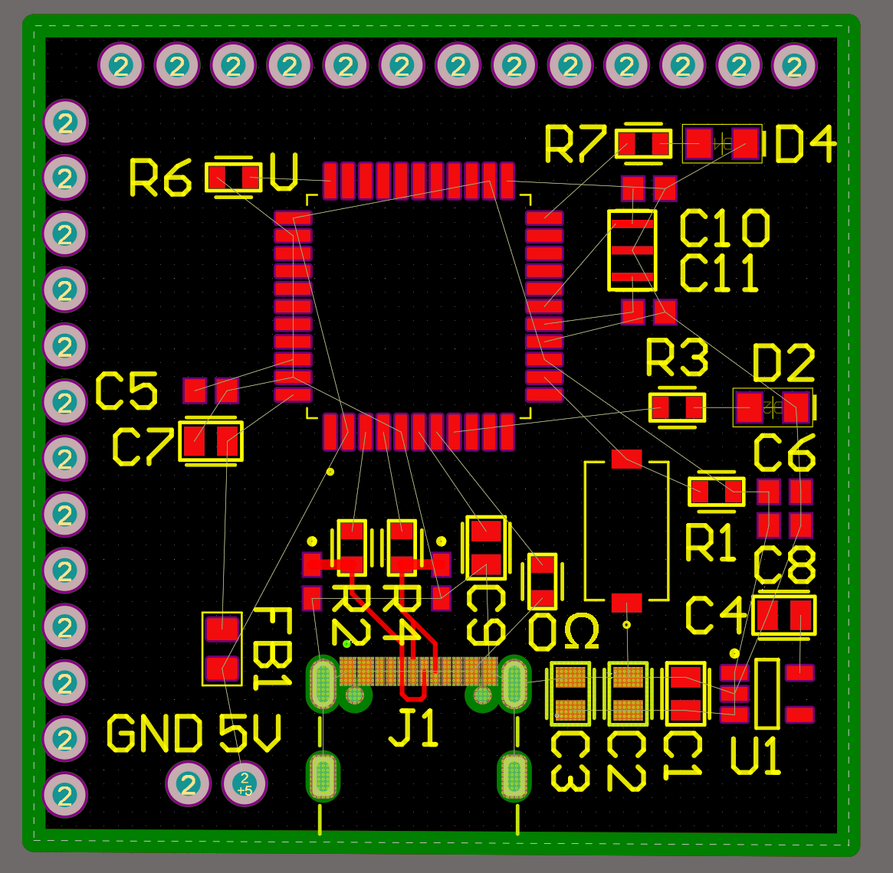
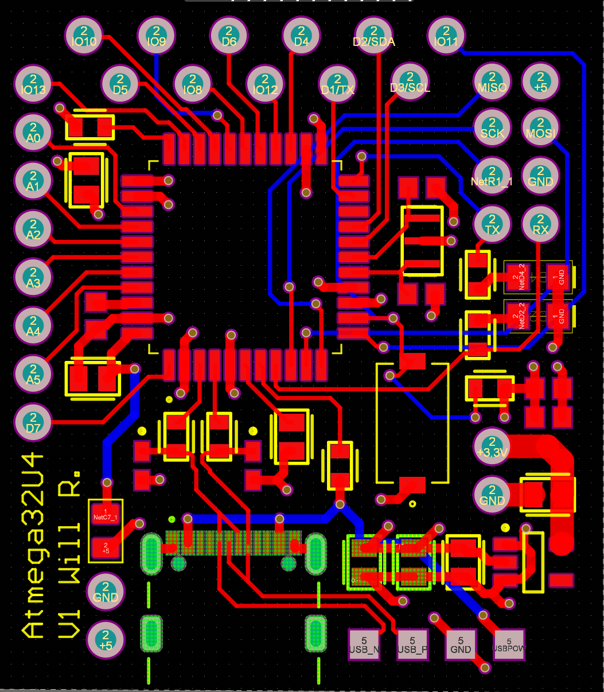
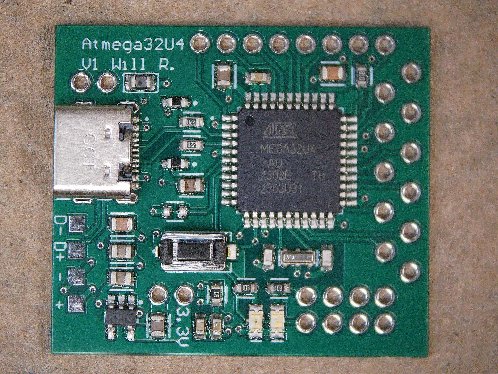
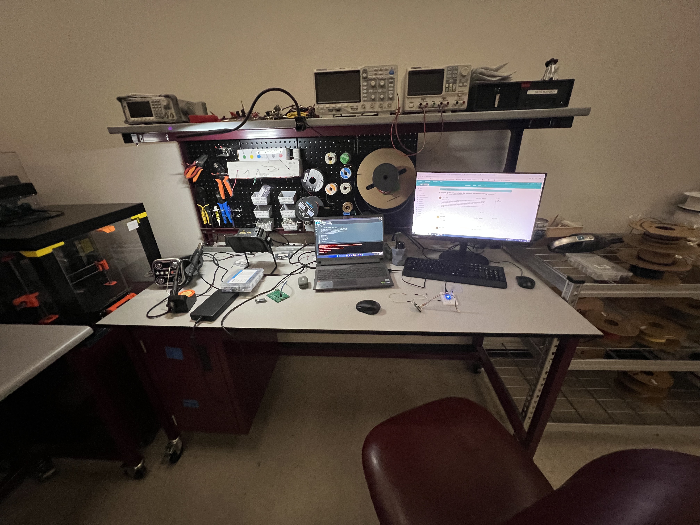
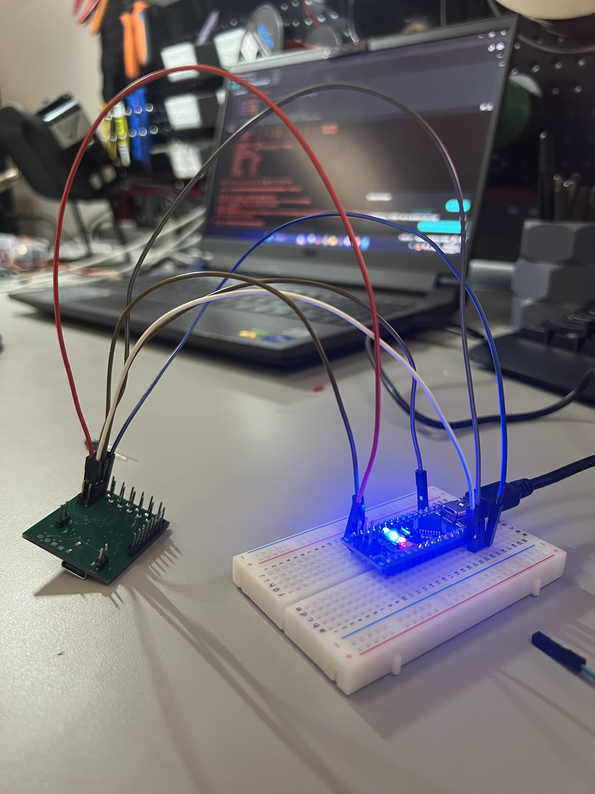
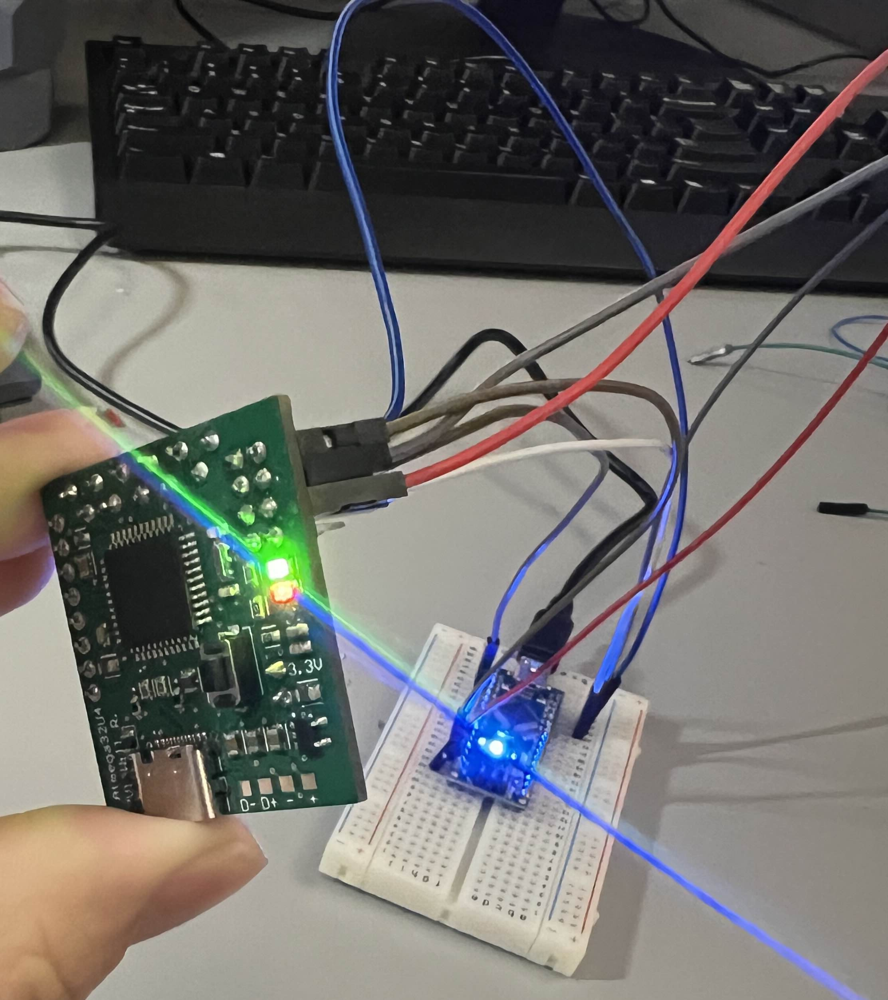
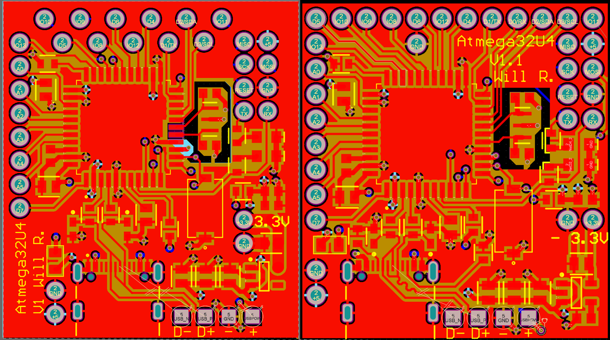
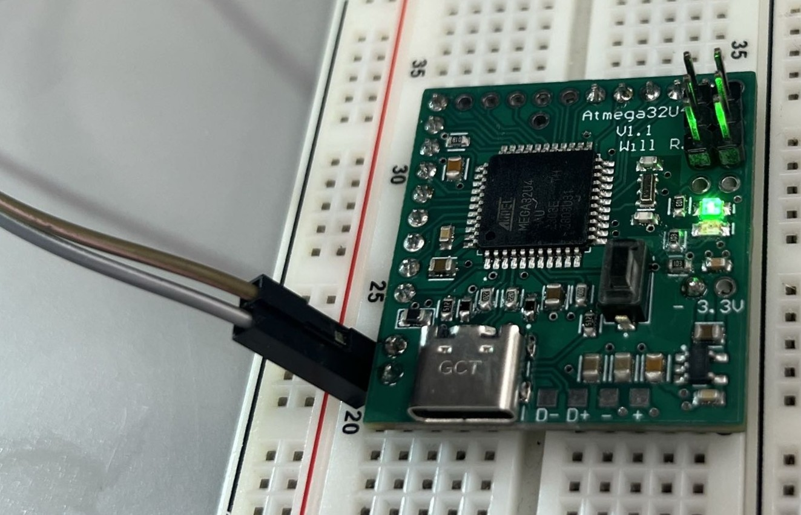

A custom ATmega32U4 dev board designed in Altium, manufactured by JLCPCB. USB-C fought back. ICSP won.

**STATUS:** V1.1 built and working over ICSP. USB-C never enumerated; root cause not confirmed.
 
<!--more-->
# 
### Background
 
The ATmega32U4 is the same chip at the heart of the Arduino Leonardo, a well-documented, capable microcontroller with native USB support built in. The difference between buying a Leonardo for $25 and designing your own board around the same chip is that buying one teaches you nothing about why it works.
 
This project is **heavily inspired by [The Curious Scientist](https://bio.site/curiousscientist)**. He pointed me toward the ATmega32U4 in the first place. I didn't use any of his designs directly, but his work was the catalyst. All the schematic and layout decisions here are my own.
 
---
 
### Project Timeline
 

 
I'd been curious about digital PCB design for a while but had never had a concrete reason to sit down and actually do it. The dev board concept solved that. It's a contained problem with clear success criteria (does it enumerate? does firmware upload? do the pins work?) and enough complexity to actually teach me something.
 
The specific goals going in:
 
- Learn Altium Designer from a blank schematic to manufactured board
- Understand what it actually takes to get a bare microcontroller running. Crystal oscillators, decoupling, USB pull-up resistors, the works
- Flash firmware without relying on a bootloader-equipped board as a crutch
- End up with something usable for future embedded projects
I went with a 4-layer stackup (signal / ground / power / signal) to keep the power planes clean and give the high-frequency USB lines a proper reference.
 

 

 
The first layout had the pin headers arranged in two perpendicular rows. Once I started placing the actual chip footprint and routing traces, it became obvious there was a lot of wasted board real estate. The geometry didn't make sense for the chip's pinout.
 

*Early layout iteration. Perpendicular pin headers, too much dead space*
 
I switched to a staggered pin header arrangement, which let me pull the overall board footprint in significantly. I also added a dedicated 2×4 header block: six pins for ICSP (In-Circuit Serial Programming) and two more for TX/RX. The plan was to use ICSP only for burning the initial bootloader, after which the USB-C port would handle everything.
 

*Final V1 layout. Ground and power planes hidden. They live on the inner two layers*
 

 

 
The boards came back from JLCPCB, I ordered components from DigiKey, and spent about two hours hand-assembling the first prototype. Got the bootloader flashed via ICSP without any issues.
 

*Assembled V1 Board*
 

*Workbench at the MEEN Rapid Prototyping Studio*

---
 
Then I plugged in the USB-C cable and nothing happened. Posted about it in the [Starforge Discord](https://www.starforgefoundry.com/), a local makerspace here in College Station, and got the answer within a few minutes: I'd left the CC pins floating.
 
USB-C uses the CC (Configuration Channel) lines to negotiate the connection before anything else happens. With them floating, the host-side controller never sees a valid handshake, and the port stays silent. The fix is a pair of 5.1kΩ pulldown resistors on CC1 and CC2, a detail I'd missed entirely when designing the power delivery section.
 
ICSP still worked fine, so the board wasn't dead, just permanently tethered to a bundle of six wires any time I wanted to upload new firmware. Inconvenient, but workable enough to keep going.
 

*ICSP wiring setup*
 

*Onboard LEDs turn on!*
 
I got some LEDs blinking, verified the GPIO pins were responding correctly, and started noting everything I wanted to change before spinning a second revision.
 

 

 
The redesign in Altium addressed the CC pin issue and a handful of layout annoyances that had been bothering me since the first prototype:
 
- **CC pulldown resistors added**: 5.1kΩ on CC1 and CC2, the standard fix for USB-C device-side implementation
- **IO header layout changed** from staggered to inline. Cleaner and more breadboard-friendly
- **Pin spacing audited** across the whole board to make sure everything would actually land on 0.1" breadboard pitch
- **Component placement tightened up** to reduce dead space

*V1 (left) vs V1.1 (right). Inline headers, CC resistors added, tighter layout overall.*
 
The boards shipped from Hong Kong with some delays, but eventually arrived. Assembly went smoothly.

*V1.1 PCB assembled & powered on*
 
And then I plugged in USB-C again. Still nothing.
 
The CC resistors were present and correct, so the handshake issue from V1 should have been resolved. My best guess at what went wrong is signal integrity on the D+/D- differential pair. USB full-speed has tight requirements around impedance control and trace length matching, and I don't have high confidence that I routed those lines cleanly enough to meet spec. USB-C in general is less forgiving than most people expect: the physical layer has to be right before any of the protocol layer even gets a chance to run. I never fully diagnosed the root cause.
 
ICSP remained the programming path for V1.1 as well. After uploading the Arduino Leonardo bootloader, the board ran firmware without any issues, just without the convenience of USB.
 

 

 
V1.1 is functional as a bare-metal development platform when used with ICSP. The GPIO pins work, firmware uploads cleanly, and the board does everything a dev board needs to do except enumerate over USB the way it was supposed to.
 
If there's a V1.2, the priority list is:
 
- **USB-C signal integrity**: properly controlled impedance on the D+/D- pair, careful trace length matching, and potentially a USB-C ESD protection IC to give the interface a better chance
- **Width reduction**: the current board spans the full width of a standard breadboard, which means no room on either side for jumper wires. Shaving 0.1" off the width (at the cost of a slightly taller board) would make it significantly more usable

The bigger lesson from this project is that USB is harder than it looks. There are two or three distinct layers where something can go wrong (the physical layer, the enumeration handshake, and the device descriptor) and if any of them fail, the host side just sees nothing. Buying a Leonardo and treating it as a black box would have been faster and cheaper. It also would have taught me none of this.
 

 
---
 
# 