A custom single-cell Li-ion charger / boost / protection PCB. Worked for charging. Worked for boosting. The protection circuit got the MOSFET backwards.
 

**STATUS:** Shelved January 2025. Replaced by off-the-shelf modules for the projects I would've used it on.
 
<!--more-->
 
# 
 
---
 
### Background
 
I was running on a pile of 18650 cells salvaged from an old laptop battery and wanted a clean way to charge them and pull regulated 5V or 12V back out. The off-the-shelf TP4056 modules I'd been using worked, but they didn't include a boost stage, which meant every project that wanted a higher voltage needed a second board floating around with jumper wires. The plan was to consolidate charging, protection, and boost regulation onto one PCB I could design and learn from.
 
---
 
### Project Timeline
 

 
The starting point was an old Dell laptop battery a friend gave me. Disassembling the pack got me 30 lithium-ion 18650 cells in various states of health. The cells were originally welded into series-parallel groups with nickel ribbon, which had to come off before I could use them individually.
 
A handful of cells had punctured insulation around the (+) terminal from removing the ribbon, so those got duct-taped before going into storage. The rest came out clean.
 
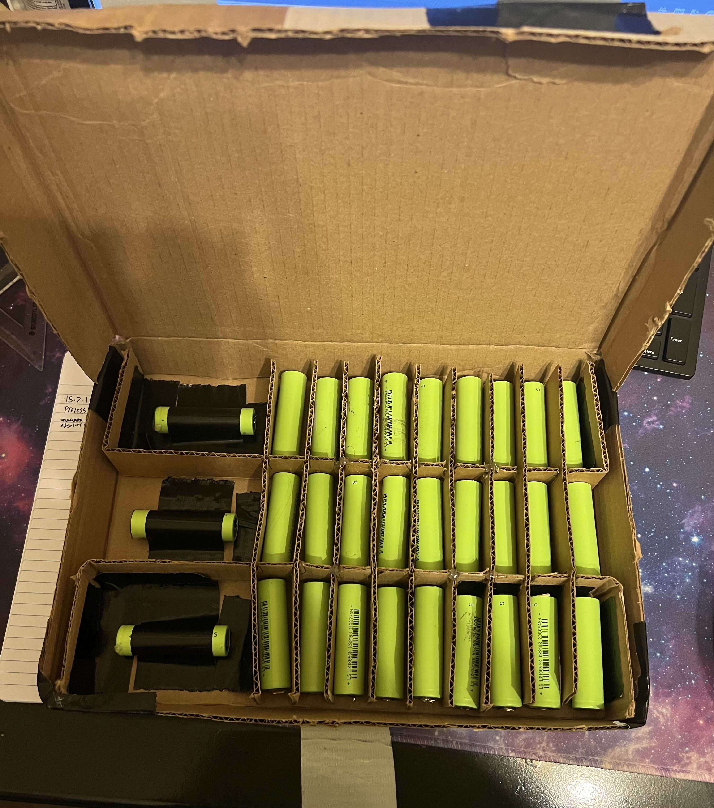
*30 cells in cardboard. The taped ones had nicked insulation around the positive terminal*
 
That left me with 30 cells and no way to charge or use them.
 

 

 
The first stop was AliExpress. I picked up a batch of TP4056-based charger modules: USB-C input, easy through-hole pads for battery and load connections, and a built-in protection IC handling over-discharge, over-voltage, and short-circuit cutoff. Spec sheet claimed 1A charging and up to 3A continuous discharge, which was plenty for what I wanted.
 
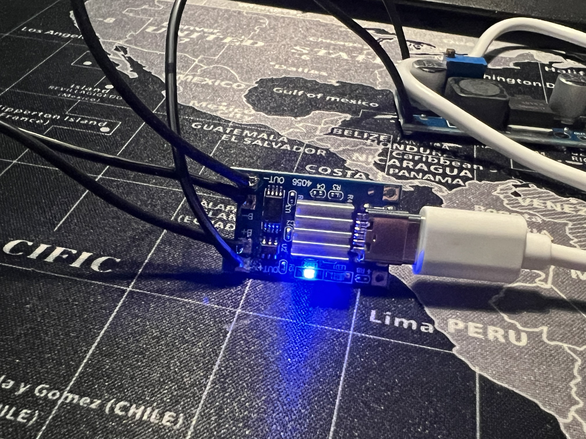
*Off-the-shelf TP4056 charger module*
 
The boards worked, but they only handled the charging side. To get a steady 5V or 12V out, I had to add a separate DC-DC boost converter board (also off AliExpress, also with its own quirks). The boost board had a trimpot for variable output voltage, which I never needed. In every project I've ever wanted to power, the answer is 5V or 12V, never something in between.
 
The result was two boards floating around with a lot of jumper wires between them. It worked, but it begged to be one board. That's where the project actually started.
 

 

 
I batched the V1 board with another order I was sending to JLCPCB at the time (a [V2 alarm clock](/posts/alarm-clock/) board) to save on shipping, which meant compressing the schematic and layout work into a tight window. In retrospect I rushed it. I should have spent another week on the protection circuit specifically, but at the time the deadline was the deadline.
 
The architecture was straightforward: TI's BQ24074 as the charging IC, a TPS3700 over-voltage / under-voltage window monitor watching the battery, an N-channel enhancement MOSFET that the TPS3700 was supposed to switch to disconnect the battery if it ever fell outside the safe window, and a DC-DC boost stage on the output with a feedback divider sized for either 5V or 12V depending on which resistor was populated.
 
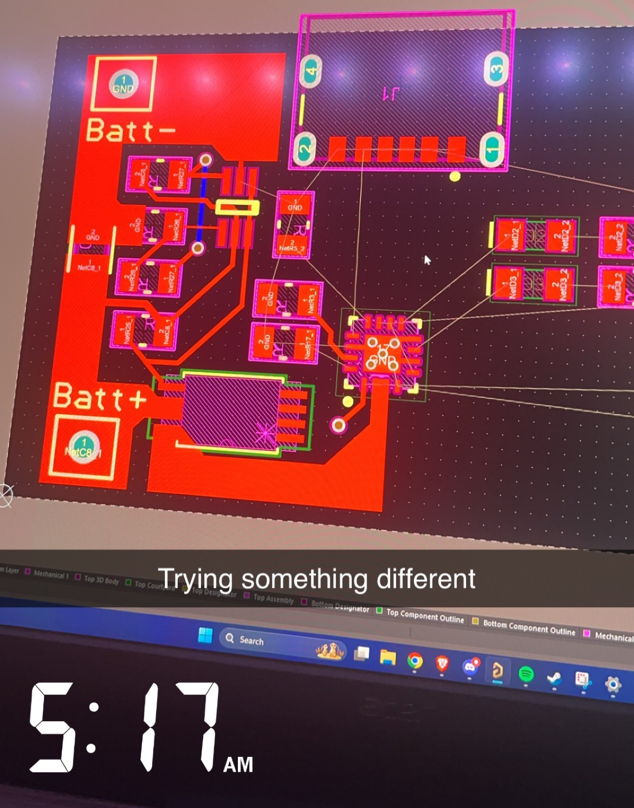
*Early V1 layout iteration*
 
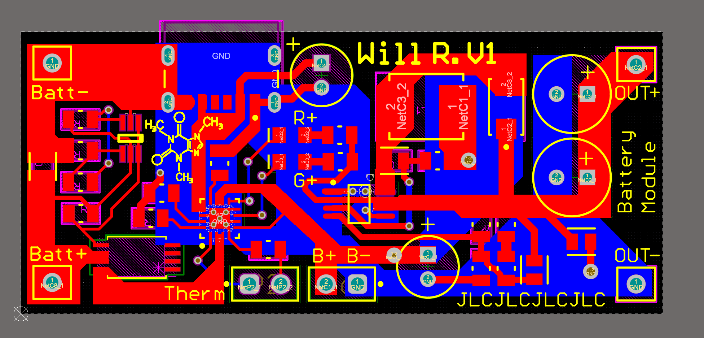
*Final V1 layout sent to JLCPCB. Caffeine molecule on the silkscreen drawn in Notability*
 
The boards came back, I assembled the first prototype, and after confirming there were no obvious shorts I plugged in a single cell. After a little fiddling, 5V on the output. Swapping the feedback resistor and re-testing got me 12V. Charging from a bench supply also worked, although somewhat awkwardly. I'd forgotten to break out a separate 5V input pin, so testing the charge path required clipping leads onto the USB pads.
 
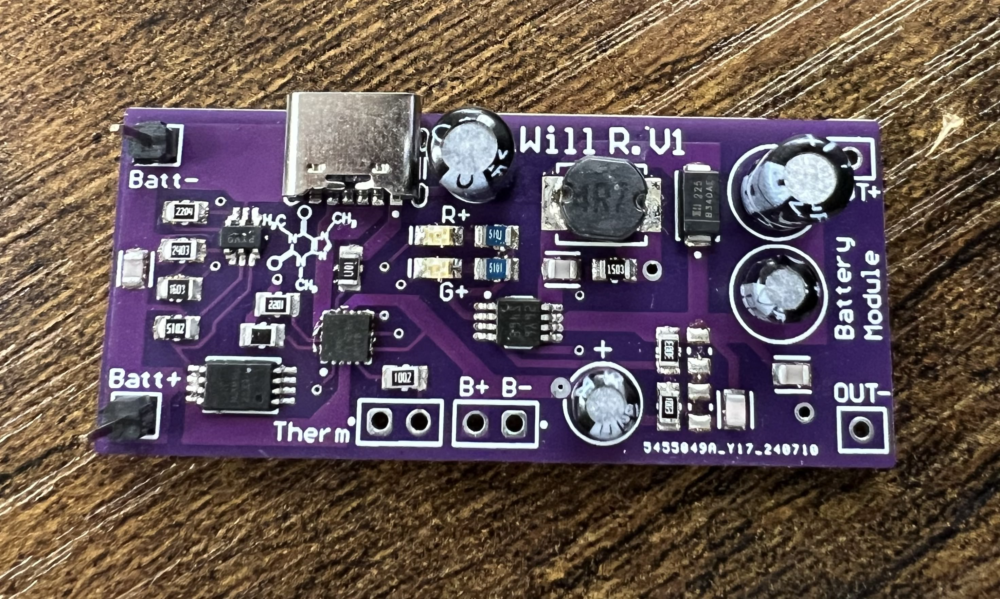
*V1 fully assembled. Quarter for scale*
 
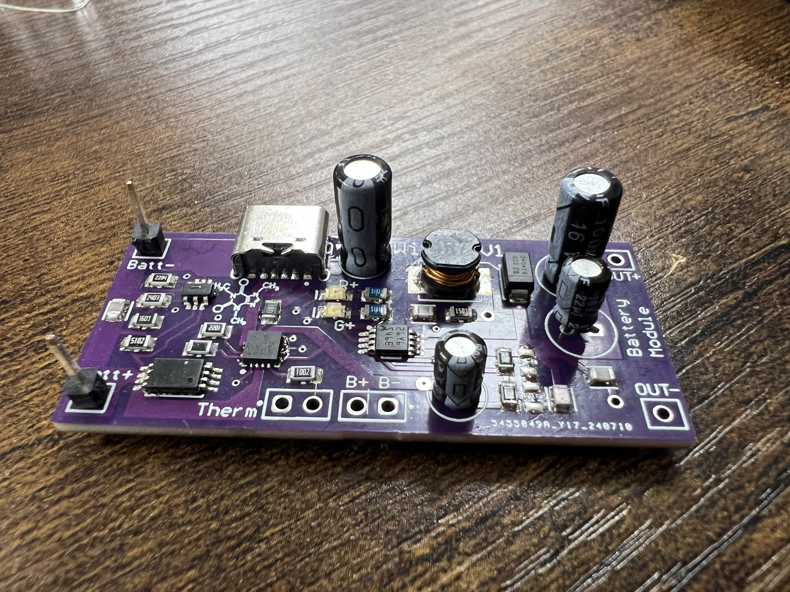
*Side view. Visible inductor and electrolytics from the boost stage*
 
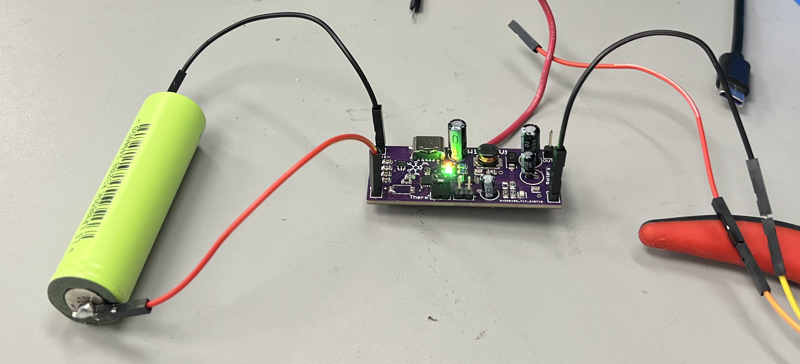
*Charging an 18650 from the bench supply*
 
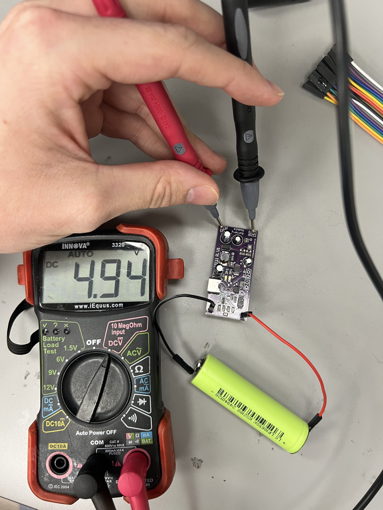
*5V on the output, single cell on the input*
 
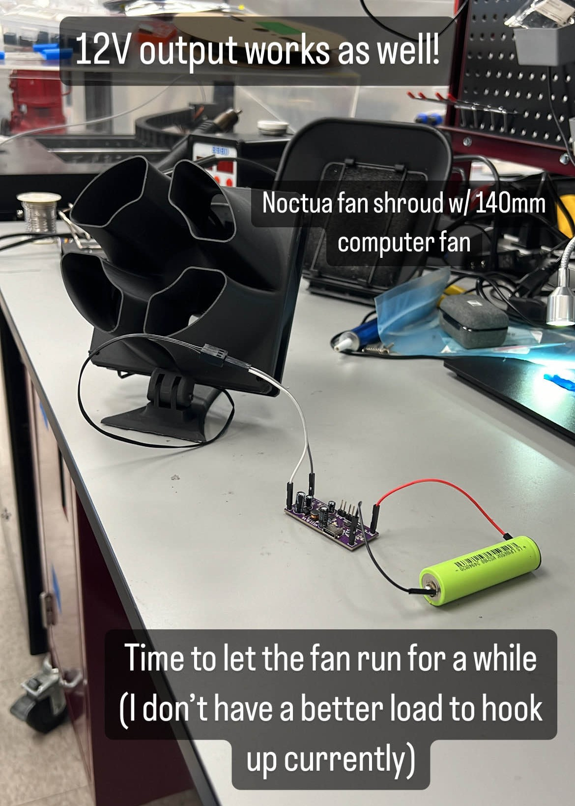
*12V output after the feedback resistor swap*
 
Charging worked. Boosting worked. The protection circuit, however, didn't.
 

 

 
My birthday landed on a Monday with summer-class lectures, which I dealt with by spending the afternoon afterward on the bench debugging the V1 board. The TPS3700 monitor was reading the battery voltage correctly and asserting its output the way it was supposed to, but the MOSFET it was driving wasn't actually disconnecting anything. Pulling the cell down to a deliberately under-voltage state and watching the load current didn't change anything.
 
I posted in the [Starforge Foundry Discord](https://www.starforgefoundry.com/), the local College Station makerspace, and worked through the circuit with people there. The eventual diagnosis: I'd wired the N-channel MOSFET in backwards relative to current flow, which made the body diode the only conducting path and made the gate signal essentially decorative.
 
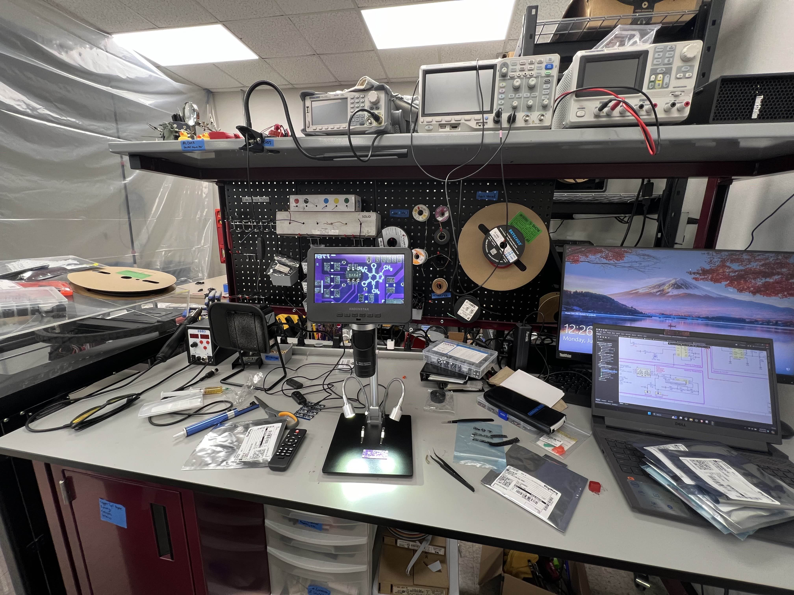
*Bench setup during the debugging session*
 
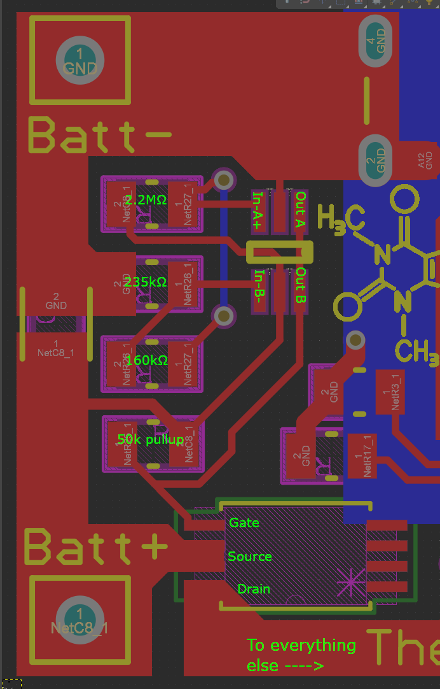
*Hand-drawn analysis of the protection topology and where it went wrong*
 
The fix was a schematic change, not a bodge. Body-diode-conducting MOSFETs aren't a thing you patch around with a jumper wire. That meant the protection circuit was effectively non-functional on V1, and any "fix" was going to require a V2 spin.
 

 

 
I got busy with summer classes and other electronics work, most relevantly the [ATmega32U4 dev board](/posts/atmega32u4-dev-board/), which was running in parallel. I didn't get back to this until the fall. By then I had momentum on the dev board and decided to spin a V2 of the charger at the same time, with what I *believed* was a corrected protection circuit.
 
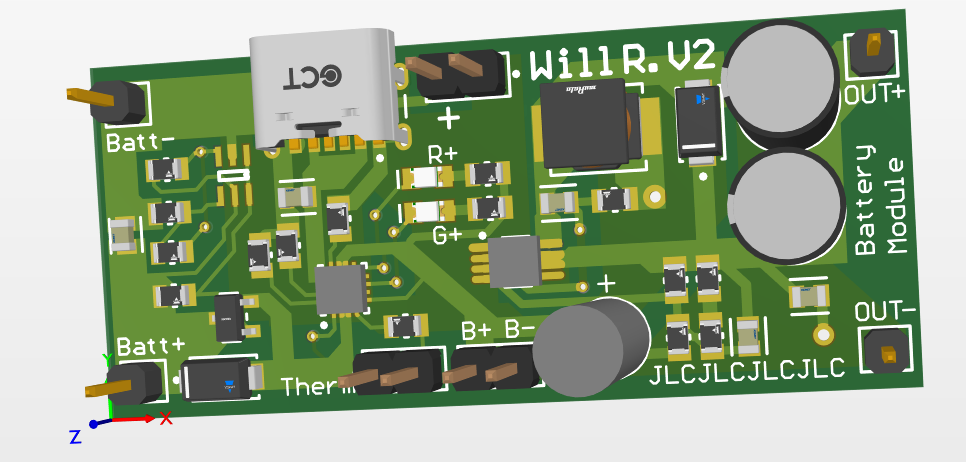
*V2 layout in 3D. Same general topology, reworked protection section.*
 
The boards arrived, I assembled one, and went through the same V1 test routine: bench supply current-limited to 0.5A, no battery on the input, just looking for a clean power-up. The current limiter pegged immediately. Dead short somewhere on the board.
 
The clue: the BQ24074 charging IC was getting *really* hot, very fast. That points at either a solder bridge under the IC (likely, since QFN packages with hand-applied paste are exactly where bridges hide) or a layout error around its power pins (less likely but possible). I never got far enough to distinguish between the two. The right move would have been to rework the IC and try again, or assemble a second board fresh from a different paste application.
 
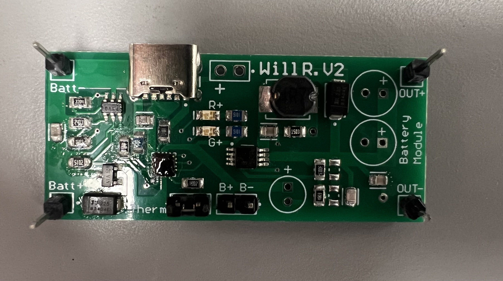
*V2 assembled PCB*

 
That's where the project sat when I shelved it.
 

 

 
The board hasn't been touched since January 2025, and it isn't coming back. The [ATmega32U4](/posts/atmega32u4-dev-board/) work absorbed the rest of that spring, [SAE Aero](/posts/sae-aero/) ramped up in May 2025, and at no point in any of that did I find myself wishing I had a discrete charger / boost / protection PCB sitting on the shelf. The need that drove the original design just didn't materialize.
 
For new work, most relevantly the avionics PCB on Project SAVIOR (described at the end of the [SAE Aero page](/posts/sae-aero/)) I've moved to a battery-management SoC: a single chip that handles charging, protection, and boost regulation in one package, with a known-good reference layout and a much shorter list of ways for a beginner to get the protection topology wrong. The **IP5306** in particular is what I'd reach for now. I didn't know it existed when I started this project. If I had, I would have used it from the start instead of trying to source separate BMS, boost, and protection ICs and validate the combination by trial and error.
 
That's the actual takeaway. Picking ICs by parametric search across a Digi-Key catalog with hundreds of similar options is a hard problem on its own, and trying to do that *while also* learning protection-circuit design from scratch made both halves harder than they needed to be. The right move as a beginner is to find a battle-tested reference design, or better, an SoC that bundles the topology you'd otherwise have to derive, and *then* start understanding the trade-offs. I had it backwards. The MOSFET wasn't the only thing on this project that was.
 
For the record, this is also the second board in my portfolio where USB-C ends up at or near the scene of the crime. The [ATmega32U4](/posts/atmega32u4-dev-board/) couldn't enumerate over USB-C for data, and this one didn't survive USB-C for power. There may be a lesson in there about how much I've been underestimating the connector.
 

 
---
 
# 
 