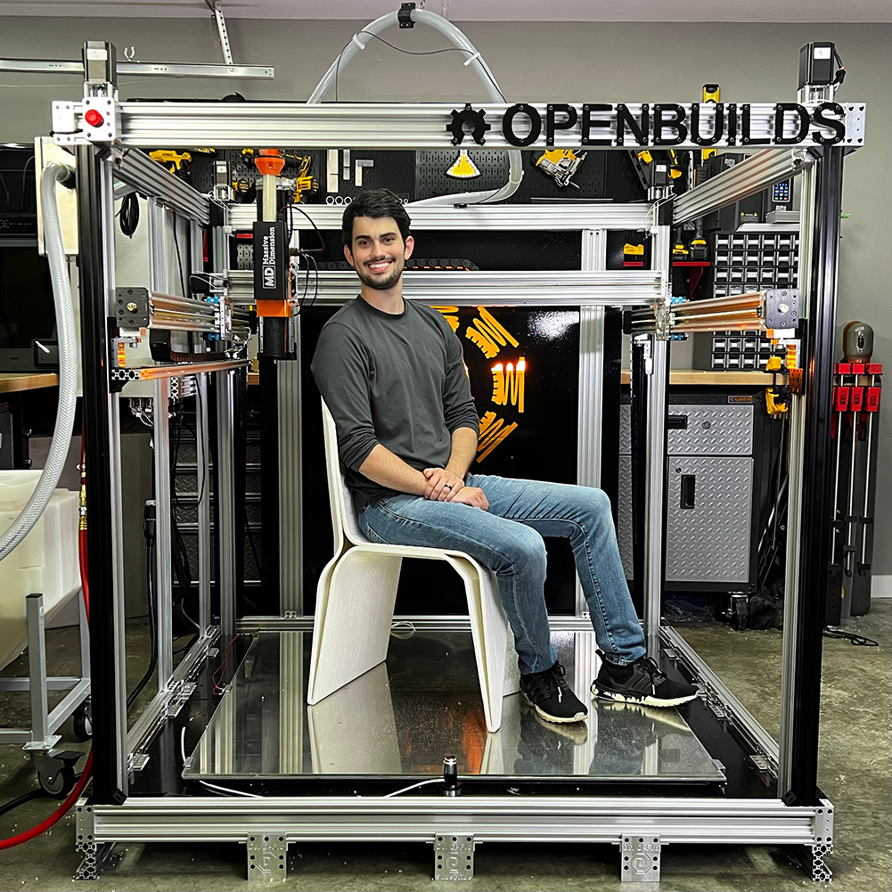
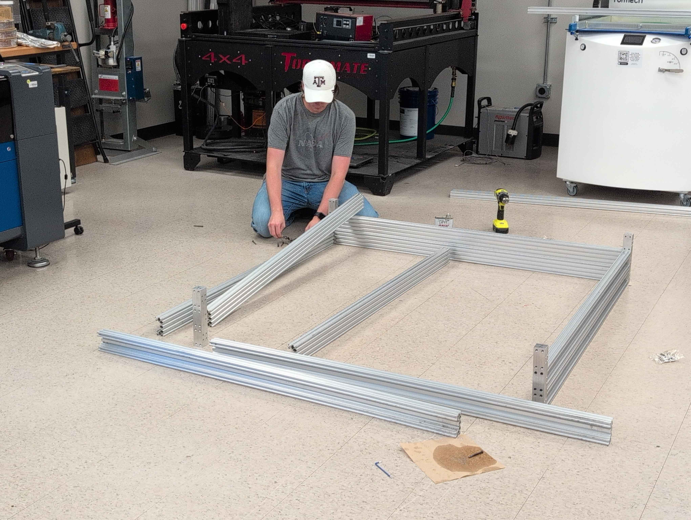
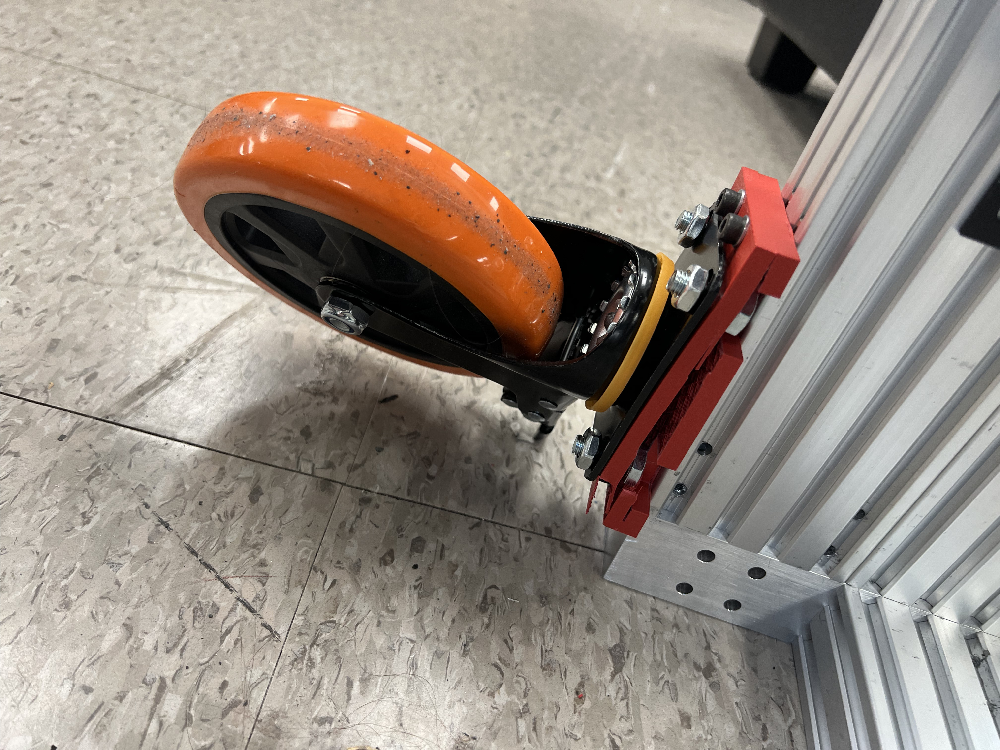
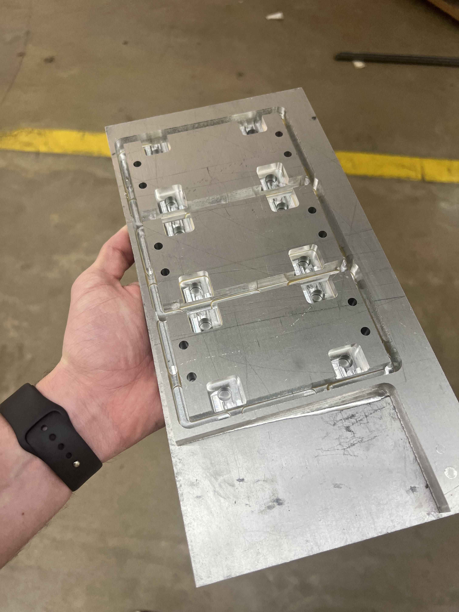
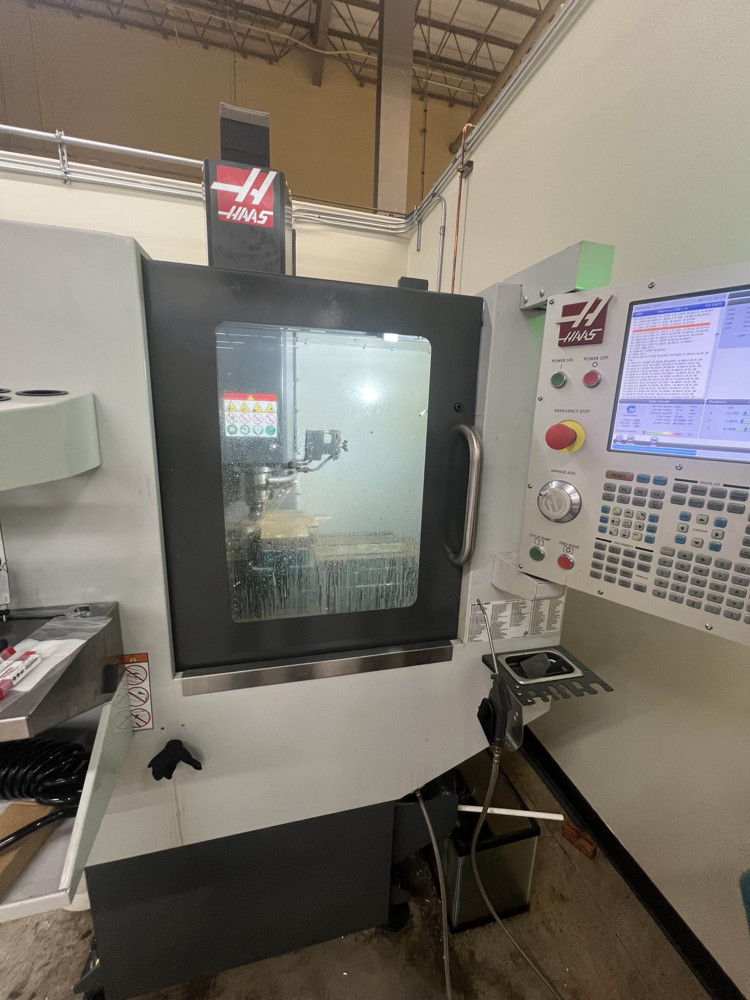
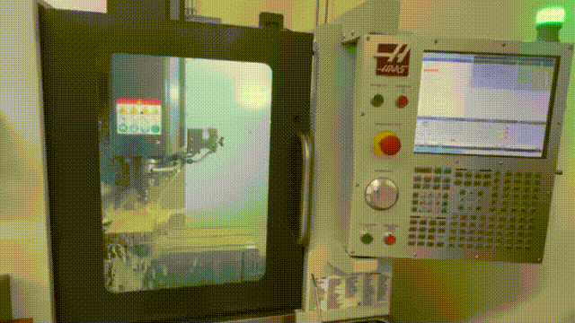
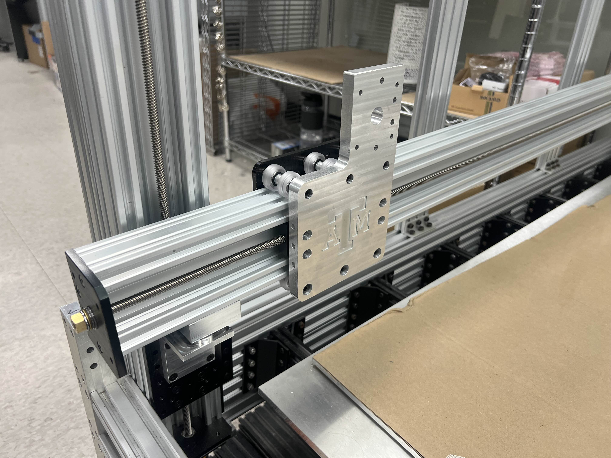
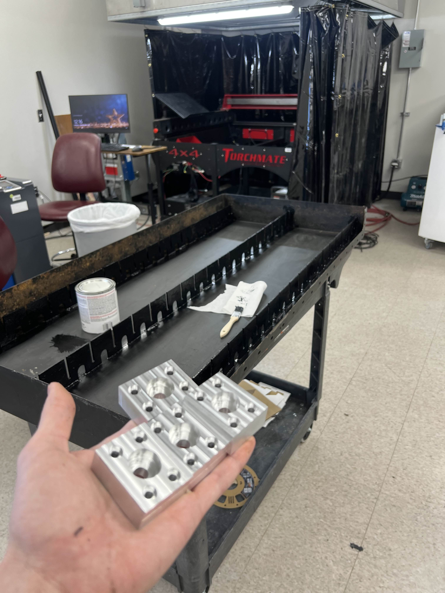
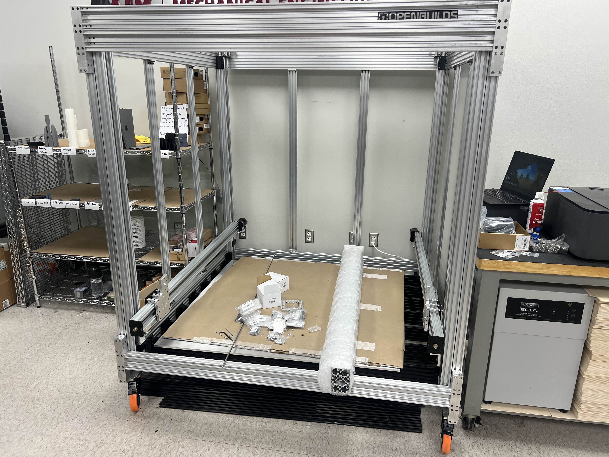

A large format pellet-extrusion 3D printer built at the RPS, based on Dr. D. Flo's open-source LF3DP design. I owned the gantry build through early 2025, then handed it off.
 

**STATUS:** Partial assembly. X-axis carriage built, waiting on machinist to trim the C-channel extrusion and install electronics. Will not finish before I graduate.
 
<!--more-->
 
# 
 
---
 
### Background
 
This is a project from my work at the **Rapid Prototyping Studio (RPS)**, not a personal one. The original justification was that the SAE student team wanted the ability to print very large objects: carbon fiber molds for aero shells, demonstration parts, that kind of thing. The funding for those parts evaporated before they were ordered, but the RPS still had end-of-fiscal-year budget that needed to be spent or returned, so my boss bought the frame components anyway. The student-use case was always a bit of a stretch. Minimum viable print volume on a machine this size is around 5 kg of PLA pellets, which is well outside of the realm of what 99.99% of students would utilize for classes/research/clubs.
 
The build is based on **[Dr. D. Flo's LF3DP](https://www.drdflo.com/pages/Projects/LF3DP.html)**: his CAD, his design choices, his BOM, with small RPS-specific customizations. None of this would have been feasible to build from scratch in the time we had. He deserves the credit for the design itself.
 

*Dr. D. Flo's original LF3DP, the basis for ours.*
 
---
 
### Project Timeline
 

 
The parts sat in their boxes for about three months after arriving. Funding had been pulled from the original use case, so it was a low-priority shop project competing against a dozen other things. Construction finally started in late October.
 
The frame is aluminum extrusion forming a rectangular prism, with solid aluminum corner joints machined in-house by Ubaldo, our shop machinist. The basic frame went together over a few short sessions.
 

*Frame assembly in progress.*
 
The week after fall finals, my coworker Jackson and I stayed in College Station to work full-time for a week and knock out a backlog of shop projects: the plasma cutter, running shop air through the space, and on the LF3DP side, adding casters so the frame could be relocated as the shop layout shifted.
 
Adding casters meant designing and manufacturing adapter plates. I prototyped them in PLA on our 3D printers first to verify the geometry, then CNC'd the final versions out of 1/2" aluminum plate. The PLA prototypes broke during the swap, which honestly made the case for the metal versions for me.
 

*The PLA prototype, demonstrating exactly why we were switching to aluminum.*
 

*The CNC'd aluminum replacements.*
 
The plates were my excuse to learn CNC machining on the **Haas Super Mini Mill** at our off-campus location. Honest take: the design side is genuinely fun (Fusion CAM, toolpath planning, watching the simulation play out) but the actual setup work (workholding, setting program zero, the entire pre-cut routine) takes substantially longer than the cutting itself. New respect for full-time machinists.
 

*The Haas. Better at being patient than I am.*
 

*Cutting the aluminum caster plates.*
 
Once the spring semester started I couldn't carve out enough time during normal business hours to keep visiting the off-campus machine shop, so the rest of the machined parts on this project came from Ubaldo.
 

 

 
After winter break I started on the gantry: Y-axis, X-axis, and the Z-axis side plates that join everything to the frame. By this point the project was officially low priority on my end, since I'd also been tasked with bringing the [plasma cutter](/posts/plasma-cutter/) online and that took precedence.
 
The custom plates that hold the axes together were one of the genuinely fun parts of this build. Dr. D. Flo embellished his with a custom design, so I followed his lead and modeled ours with the Texas A&M block logo cut into them.
 

*Y-axis plate with the A&M block logo. Small detail, but a nice one.*
 
The Z-axis side plates were installed by my coworkers and my boss; my piece was bolting in the machined corner brackets (Ubaldo again) and prepping each Y-axis with motor, lead screw, and end plates.
 

*One half of the bracket assembly, repeated four times around the frame.*
 
By early March, the Z-axes and Y-axes were assembled and installed. The X-axis was prepped but not yet on the machine. The next blocking issue was thread-locking everything. We'd already started seeing screws back out from vibration, and pushing forward without dealing with that was going to compound the problem.
 

*Y-axes mounted with the X-axis ready to install.*
 
This is the point where my involvement effectively ended. The plasma cutter was demanding most of my attention, RPS foot traffic was peaking for mid-semester, and I'd lost interest in the project itself.
 

 

 
I put together the BOM for the electronics package (controller, drivers, heated bed, hotend, wiring) and Alex (one of our shop staff) placed the order. The X-axis carriage has since been fully built. The current blocker is the C-channel extrusion that runs the X-axis: it needs to be trimmed to length, and that's waiting on Mack, our newer machinist. Both Mack and Alex are planning to push the build forward this summer, including installing the electronics I specced.
 
I'm not planning to come back to this project. It's still partially assembled in the corner of the shop, and realistically it won't be operational before I graduate in December 2026. That's fine. The parts of this project I wanted to learn from (CNC machining, gantry assembly, designing custom adapter plates) are behind me, and the parts that are left (electronics integration, calibration, actually running pellet extrusion) aren't really pulling me back.
 
If it ever does come online, it'll be one of the largest 3D printers in the MEEN department. That's a cool outcome for the shop. It's just not going to be one I see through.
 

 
---
 
# 