A PhD student handed me four steel brackets epoxied together and asked me to make a plate go up and down. The actual goal: a binder-jet 3D printer that survives an autoclave.
 

**STATUS:** Shelved August 2025. Between a ridiculous amount of feature creep, and SAE Aero kicking off, I ran out of time. 
 
<!--more-->
 
# 
 
---
 
### Background
 
Summer 2025 lab project with Dr. Pei's group at Texas A&M, jointly run between the ISEN and Microbiology departments. The premise: 3D-print custom fungal-mycelium objects by depositing anti-fungal binder in a hemp-hurd or sawdust powder bed, then introducing a fungus strain that colonizes only the unbinded interior. The entire printer has to be sterilized in an autoclave (121°C steam, ~2'×2'×2' envelope) and operated in a sterile environment, so every component had to survive that thermal cycle. The mechanical side isn't particularly sensitive, but the surrounding biology research is. Anything below stays vague where it overlaps with the bio side.
 
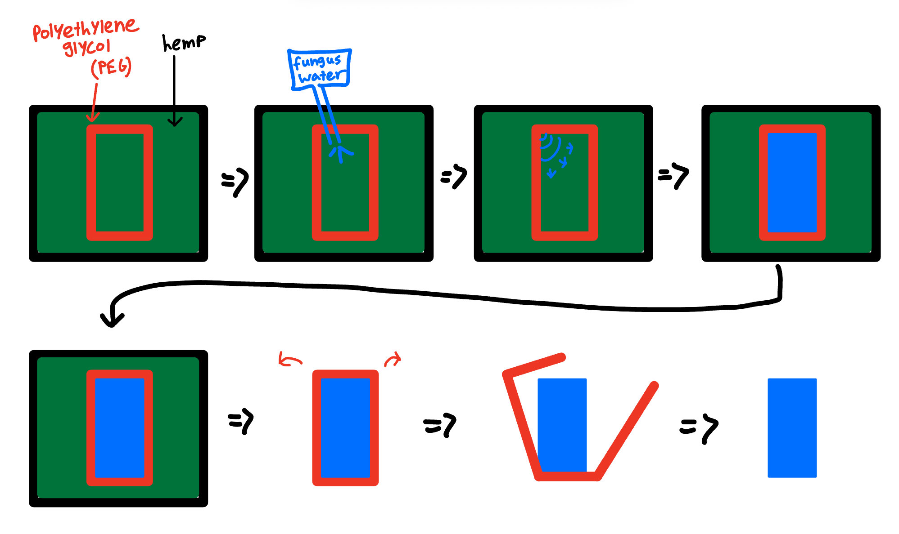
*Anti-fungal binder (red, polyethylene glycol) is deposited in a precise outline within hemp powder. Fungus water inoculates the interior, which colonizes only the unbinded volume. The outer hemp is broken away, leaving the fungus-shaped part. My job was the printer that automates the binder deposition step*
 
---
 
### Project Timeline
 

 
At the highest level, BJT printing glues layers of powder together to form a solid 3D object. Modern industrial BJT printers (StrataSYS, ExOne) use a piezoelectric printhead to dispense binder onto powder beds of titanium, tungsten, ceramic, aluminum, or various combinations to achieve specific material properties.
 
The print loop is straightforward: lower the print bed by one layer height (∂z, typically 0.1 mm), refresh a new powder layer at thickness ∂z, lay down binder in the 2D pattern for that layer, then repeat.
 
There are two common ways to refresh powder. A sifter or roller can drop fresh powder from a hopper onto the bed and roll it smooth. Or you run two job boxes side-by-side: when the print bed drops by ∂z, an adjacent feed box rises by ∂z, and a roller pushes the displaced volume across to top up the print side.
 
For the fungus printer, the powder is hemp-hurd or coarse sawdust. We tested sifting and it jammed the sieve almost immediately, so the dual-box approach was the only viable option. Push, don't sift.
 

 

 
The brief was deliberately minimal. Make a plate go up and down inside the bracket frame. Don't worry about precision, don't worry about scope. Just get something physical built so we can have a real conversation about what the project actually needs.
 
I sketched a plan on my tablet, modeled the components in SolidWorks, and used the Rapid Prototyping Studio to manufacture everything in a single day. Most of the parts were 3D printed; the build plate itself was plasma cut.
 
The result was rough. About 1 inch of total Z travel, with the plate free to wobble and rotate inside its guides because the bracket geometry wasn't precise enough to constrain it properly. None of that was the point. The point was to have something physical to hand back, learn what the project actually needed, and build enough context to start designing for real.
 
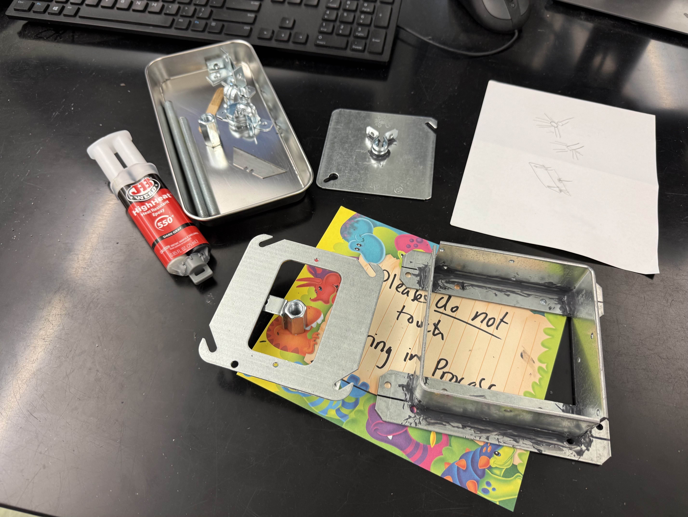
*The starting hardware: four steel brackets epoxied into a frame*
 
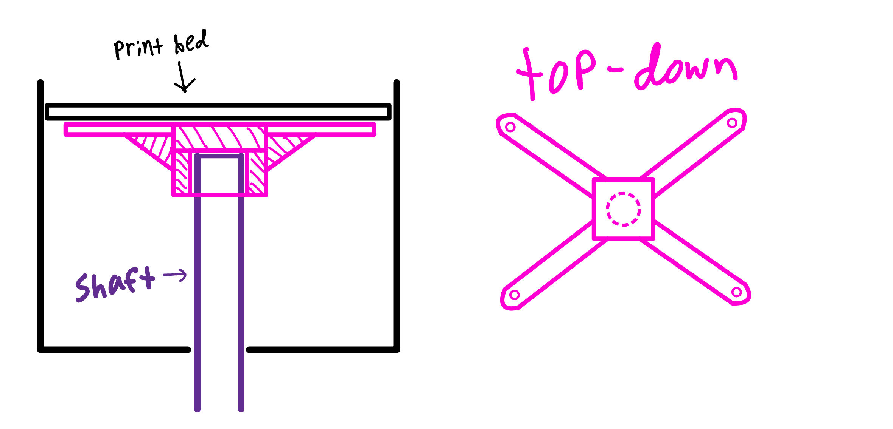
*Tablet sketch from day one. Leadscrew up the middle, guide rails on the corners, build plate on top*
 
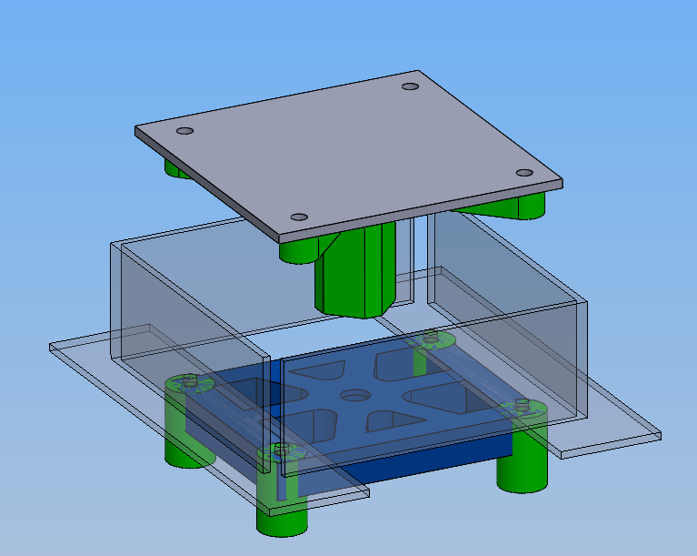
*SolidWorks model of the V1 mechanism*
 
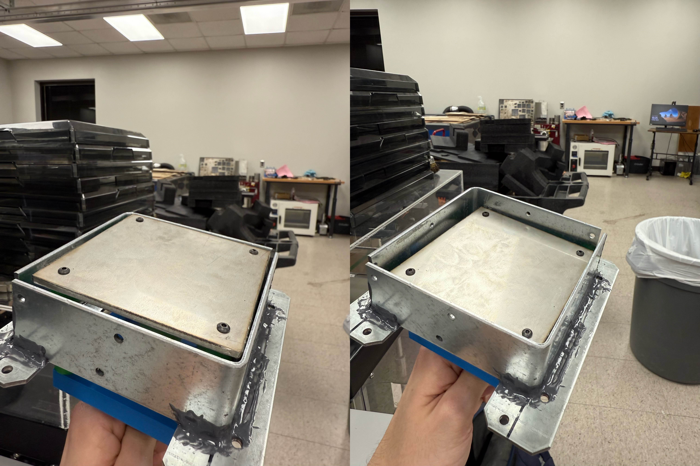
*Roughly an inch of travel, with a lot of slop in both rotation and translation*
 

 

 
By V2 I had more context. The printer needed to be sterilized in an autoclave (121°C steam) before each print, then operated in a sterile environment to keep contaminants out of the powder bed. That meant the box around the print bed needed tight, sealable corners. V1's epoxied bracket setup wasn't going to cut it.
 
The plan: bend the job box from sheet metal so the corners would be predictable and could seal against a gasket on the lid. Walls also turn out reasonably perpendicular from a press brake, which simplifies the bed-to-wall clearance.
 
I spent about six hours sketching a 2D cross-section with rough dimensions, reasoning through where each component would live and how the seal would work. Once that felt solid, translating into a 3D SolidWorks assembly took another four hours. McMaster-Carr models for hardware, custom geometry for everything else. I presented to Dr. Pei and the rest of the lab, got approval, and ordered parts.
 
The 16ga stainless steel sheet was the critical-path item, and as of when I shelved the project I was still waiting on it. That was blocking the bed and gasket design too. I wanted to finalize the box before committing to the rest.
 
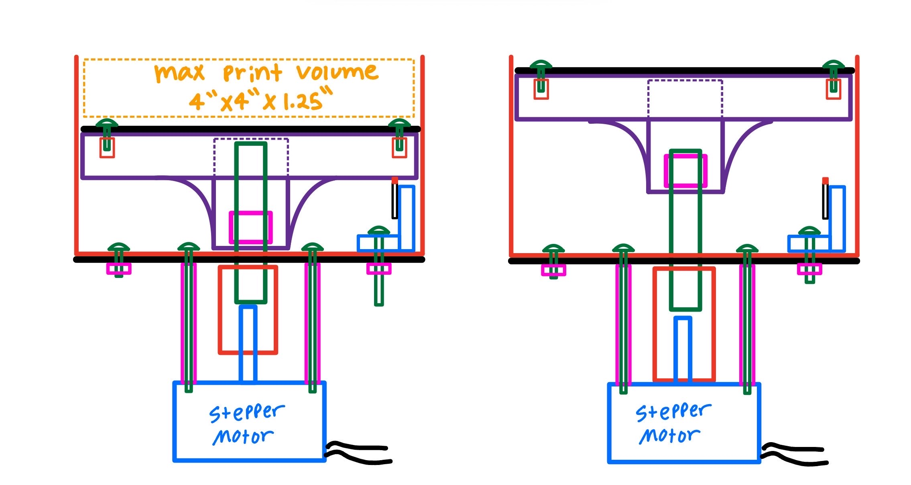
*Cleaned-up cross-section sketch with dimensions*
 
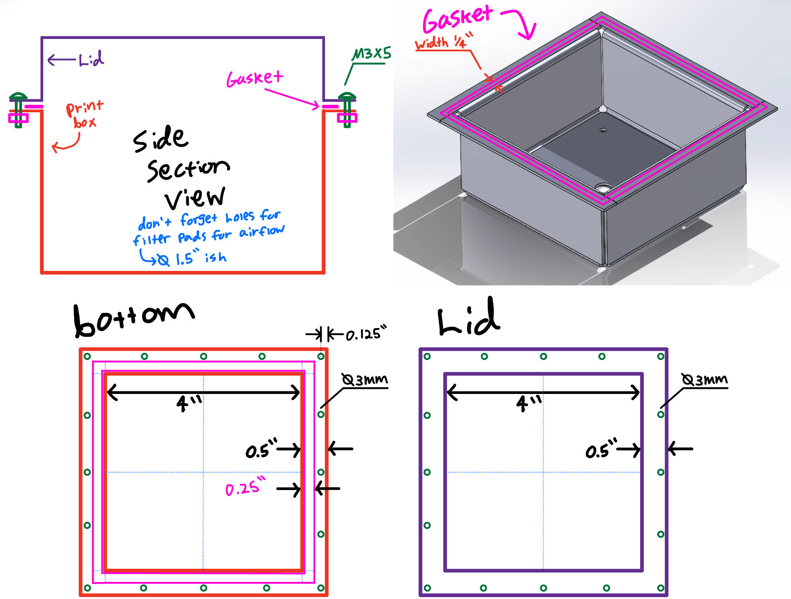
*Lid layout sketch*
 
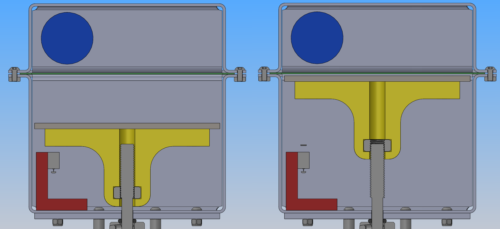
*Cross section showing lowered & raised positions*
 
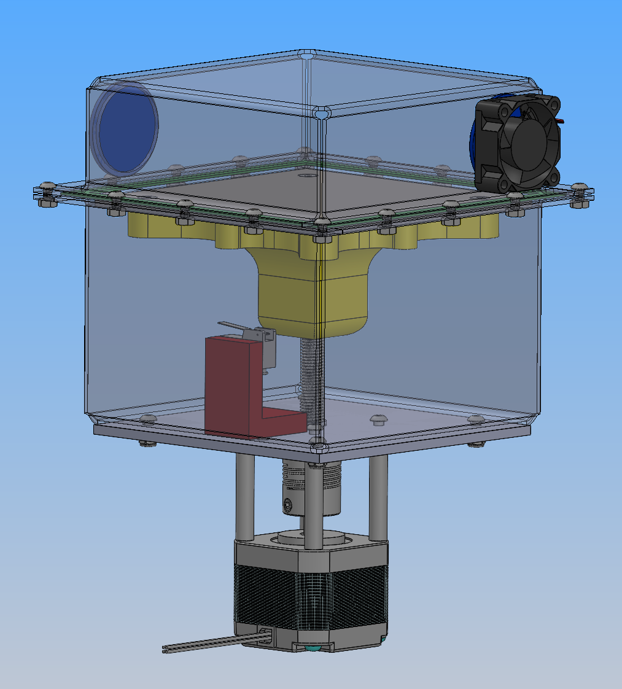
*Final V2 assembly in CAD*



*Solidworks exploded assembly*
 
---

 

### Feature Creep.

Right after the V2 review, it was revealed to me that the researchers wanted to expand the scope: the printer needed to automate everything, not just the bed. That meant adding a full X/Y gantry for binder deposition and a powder-spreading mechanism between the bed and a feed box.
 
I hadn't designed the V2 prototype to house a binder deposition mechanism, nor did I foresee any way of making it possible, so I opted to start from scratch.

For inspiration I leaned on three open-source binder-jet projects: [Project Oasis](https://ytec3d.com/oasis-3dp/), [Plan B](https://ytec3d.com/plan-b/), and the [InovaMK1](https://sls4all.com/). I wanted to see how other people had laid out the gantry, spreader, and job-box arrangement at DIY scale. For the X/Y motion specifically, I pulled the gantry from the [Voron 0.2](https://vorondesign.com/voron0.2) project, a well-documented CoreXY system I could adapt without reinventing the kinematics.
 
The full printer breaks into four mostly-independent sub-systems: the Z-axis (the print bed itself, now folded back into the larger machine), the X/Y gantry (positions the binder printhead), the roller / spreader (refreshes powder between layers), and the binder deposition (peristaltic pump feeding a nozzle on the gantry). Working through them one at a time made the overall problem tractable instead of overwhelming.
 
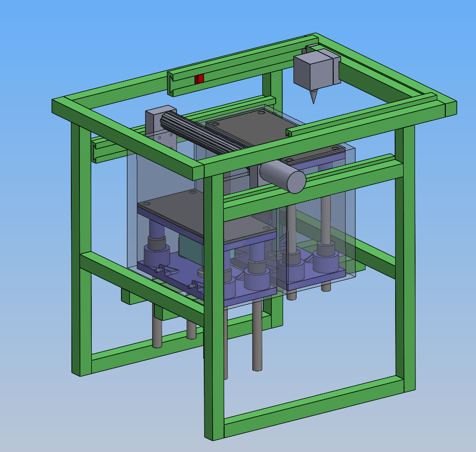
*Early concept layout. Aluminum extrusion frame (green), gantry on top, dual job boxes underneath, spreader rail in between, printhead on the gantry carriage*
 
---
### Adapting the Voron 0.2 gantry
 
The Voron 0.2 has a published CAD package, so the workflow was to import their STEP files into solidworks, convert them to the native .SLDPRT format, then mate them in an assembly. 
 
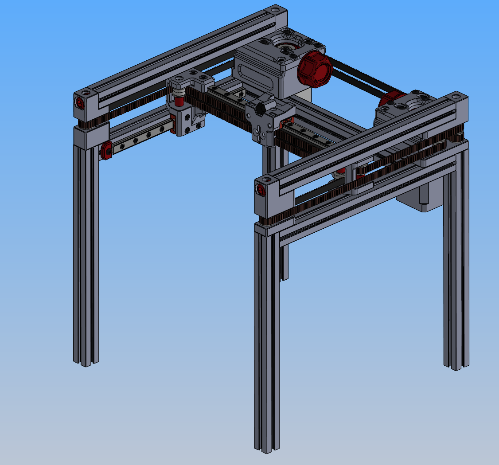
*The Voron 0.2 gantry I started from. CoreXY, twin linear rails, belt-driven from corner-mounted steppers*
 
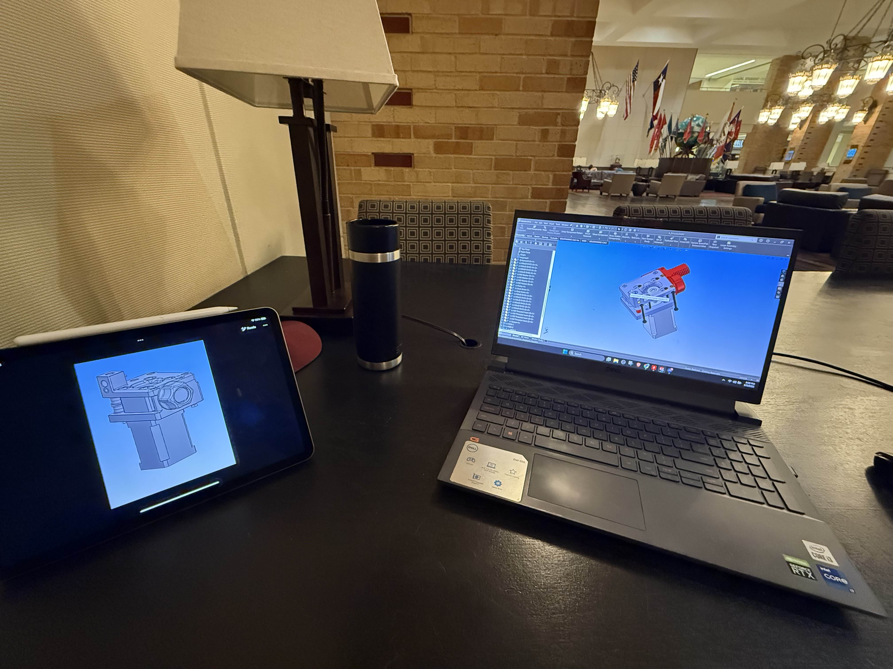
*Rebuilding the Voron components in SolidWorks*
 
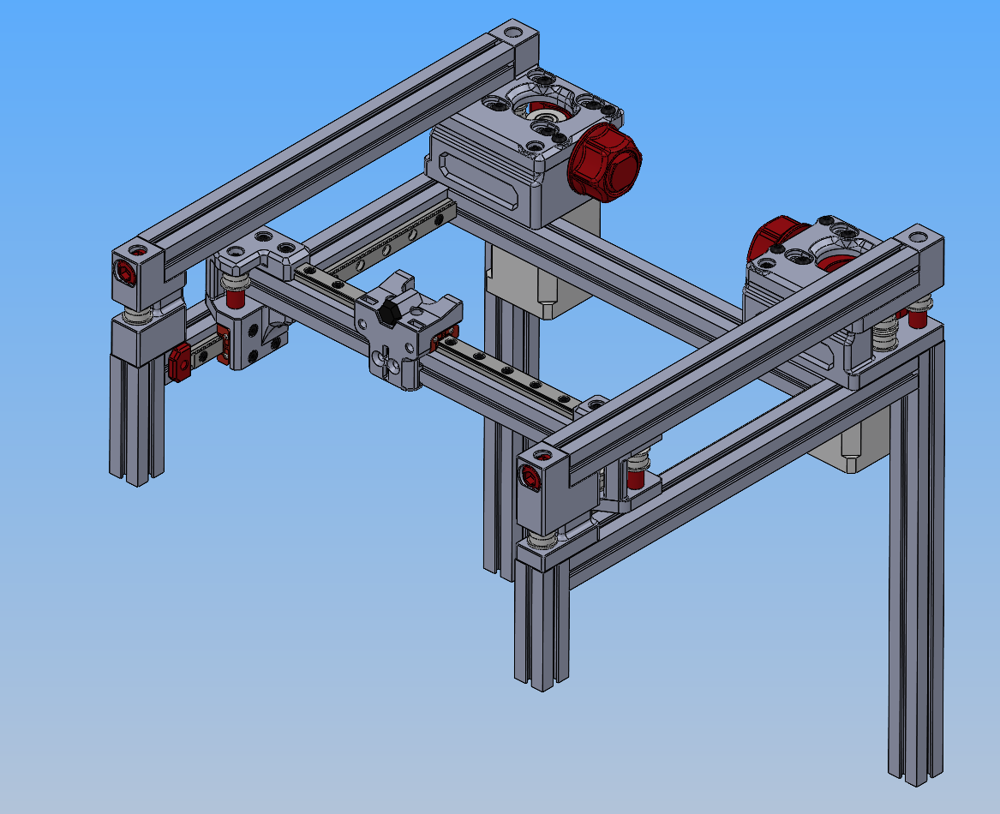
*Adapted gantry with working solidworks assembly for motion*



*X-axis frame timelapse assembly & integration into gantry CAD*

---
 
### Spreader mechanism
 
The spreader was the most interesting design piece because it has two motions happening at once. The roller has to translate across the bed, and it has to spin while it does so. 
 
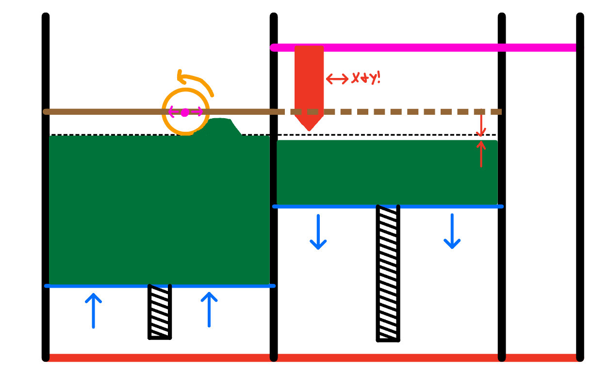
*The dual-box concept. The print bed (right) drops by ∂z, the feed box (left) rises by ∂z, and the roller translates across pushing the displaced powder onto the print side. The printhead lives on the gantry above and writes the binder pattern after the spread*
 
After a bit of thought, I took after the Oasis 3D printer and decided to just use a DC motor that would be connected to the roller either directly or via a belt so that I could more easily control its speed. 
 
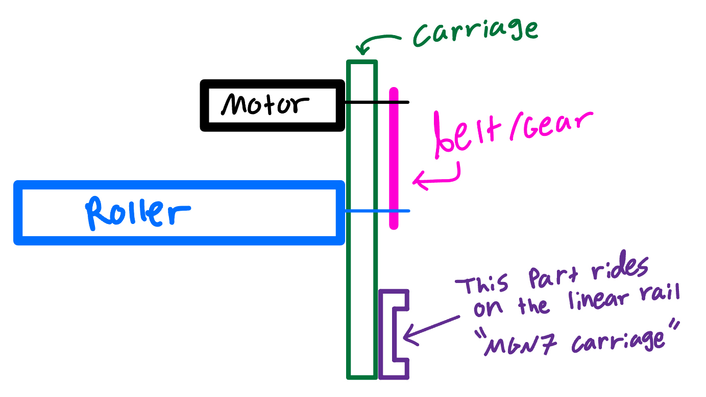
*Cleaner schematic of the integrated carriage. Motor, belt, MGN7 linear-rail block, and roller in one assembly*
 
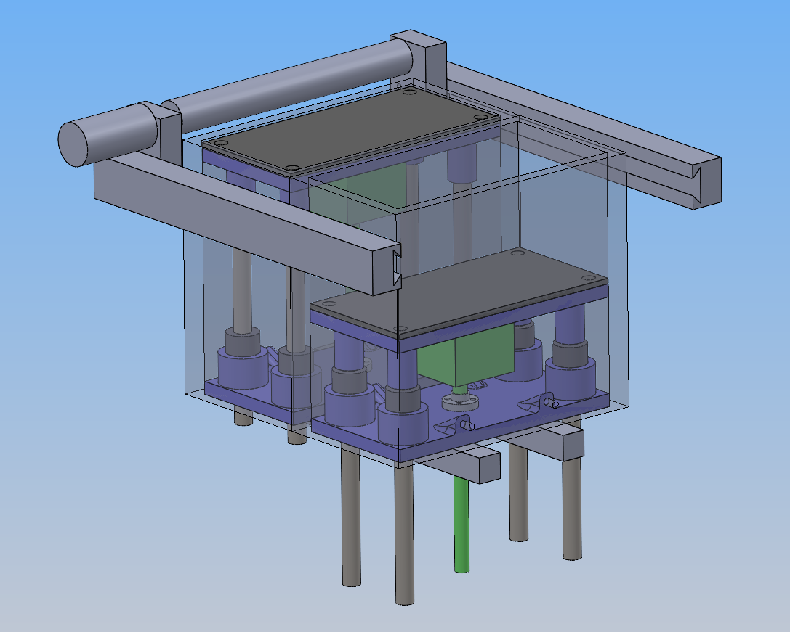
*Spreader mechanism shown with the representative job box assembly. This version ended up not working due to the motor sticking out and colliding with the frame extrusions*
 
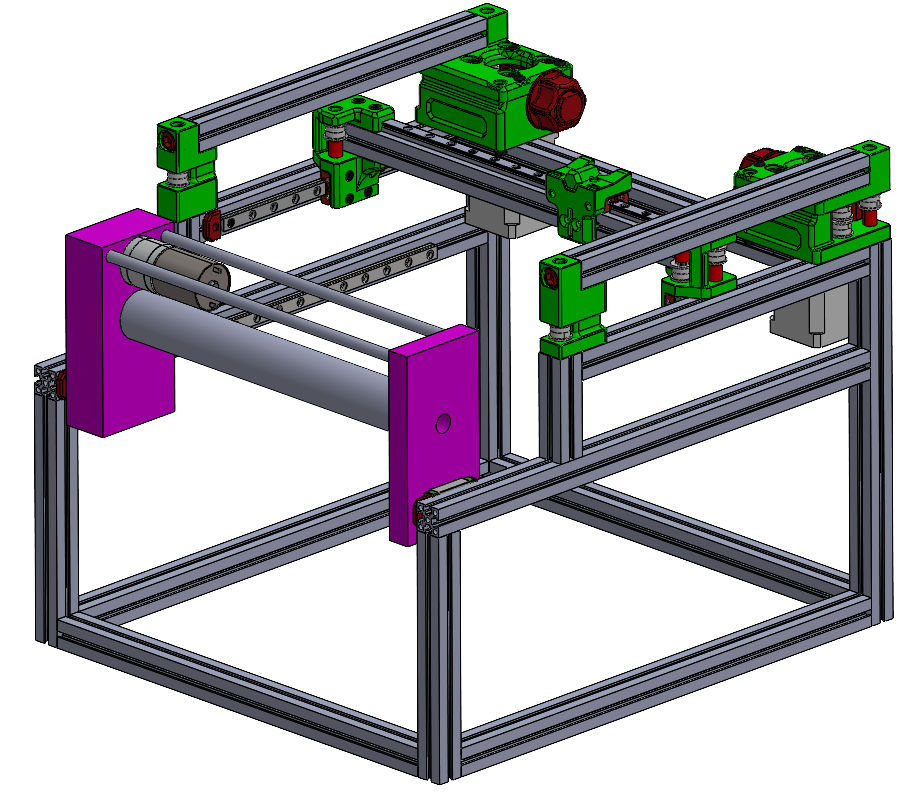
*V3 full assembly as of when I shelved the project (8/20/25)*
 


*Latest V3 CAD demonstration:*

In order:

- Dual job-box movement (powder hold & print area)
- Spreader mechanism 
- XY gantry movement (where binder dropper will go)

\* Switches to top view to show that there are no interferences
- XY gantry movement again over the right job box, before moving to the *far* right corner to be out of the way for the spreader
- Spreader mechanism again

---
 
### Open problems on V3
 
Besides for general polishing that would have needed to happen, there was one big unsolved problem by the time I shelved the project:
 
The job box mounting strategy. I went back and forth between how I would manufacture the job box, if I wanted it to be swappable, how they would survive the autoclave cycling, how it would be attached to the rest of the frame (and leveled for the sake of the spreader), and more. 
 
With some more time, I'm sure I could have come up with a good solution, but I just didn't have the time because this project was introduced to me so late in the summer. 
 

 

 
[SAE Aero](/posts/sae-aero/) ramped up in late August and consumed the time I'd been spending on this project. Around the same time, the lab side slowed down. The lead PhD student wasn't making rapid progress on the bio side, so the urgency for a working printer dropped to match. Both factors together made this an easy thing to put down without anyone particularly minding.
 
As of writing (May 2026), the V3 design is still mostly intact in CAD. The final job box design and the binder deposition system are still as yet unsolved. I'd researched the latter up to the point of wanting to use a peristaltic pump with a static reservoir of binder, but not much beyond that in terms of integration and parts selection.
 

 
---
 
# 